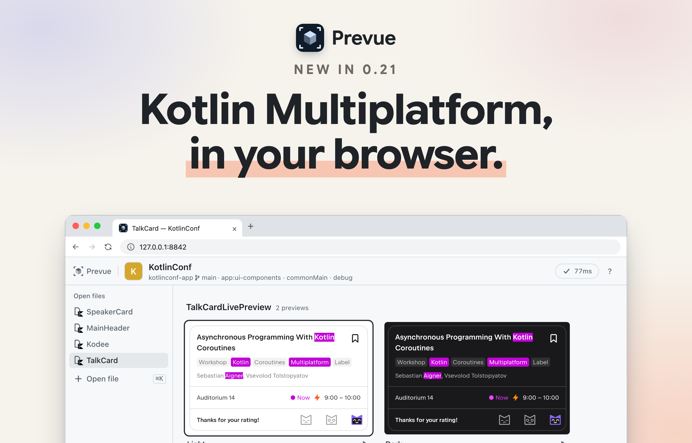
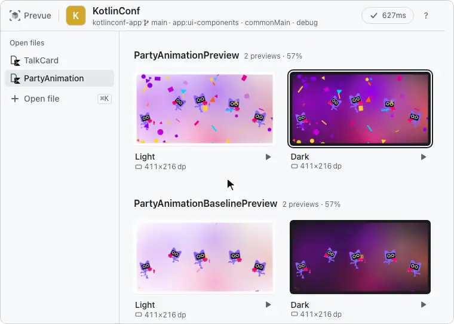

# Changelog

Only changes users can see go here.

> **A release is merging `develop` into `main`.** Each change goes under `[Unreleased]` in the PR that makes it (parallel PRs don't conflict — the file uses `merge=union`). Don't edit `plugin.json` by hand.
> To release, a version commit on `develop` bumps `plugin/VERSION` and `tools/sync-version.sh` carries it to both `plugin.json` files, the badges in both READMEs (English · Korean), and the heading in this file. Then one `develop` → `main` PR runs the "빌드 검증" (build check) workflow.
> The marketplace reads the plugin from `main`, so merging is shipping, and `version` in `plugin.json` is the switch ([docs](https://code.claude.com/docs/en/plugins-reference): *"users only receive updates when you bump it"*). Tags and GitHub Releases are created afterwards by running the release workflow by hand.

## [Unreleased]

- **A preview opened by its FQN sits on its file's board, so the back button and Esc always lead back.** `prevue show` with a function's FQN used to open that preview alone with nothing under it: the viewer showed a View | Interact switch instead of a back button, and once you switched to Interact, Esc did nothing and there was no way out but opening another file. Now it opens that function's file as a board tab (or switches to the tab if it is already open) and enters that card in interactive mode, as if you had pressed its ▶ Interactive. The back button and Esc return to that card on the board, and the other cards are drawn beside it once input has been quiet for a second. The agent's answer is still that one card and takes no longer. `--index` picks which of the function's cards when it makes several (a multipreview annotation or `@PreviewParameter`), and `prevue focus <index> --off` goes back to the board. An FQN whose source file can't be found (a preview that is not a top-level function) is now refused with "Couldn't find the source file of … — show the file path instead"; it used to be drawn alone without its `@Preview` arguments. `status` tabs no longer carry `fqn`, since every tab is a file.
- **Other cards on the board stay current while you interact with one.** After a save in interactive mode, the other cards used to keep their old pictures until you went back to the board, which then redrew them while you watched, and `prevue card` on another card answered `skipped`. Now, once input has been quiet for a second, Prevue redraws them one by one beside the interactive card without resetting it (after the other sizes and postures it already draws), so going back shows new pictures right away. Touching, resizing or saving again pauses it after the card in progress. `prevue card` on another card now draws it the same way, and `wait` still answers `complete:false` until every card is new.
- **Opening a card brings the picture first and the controls after it.** When you open a card from the board, the header's back button and preview name used to slide in the moment the picture started growing, ahead of everything else. Now they fade in with the right-hand panel as the picture lands, and on the way back they leave together with the panel before the picture shrinks. Esc and the browser's back button work right away, even before the header shows. With reduced motion, or when the card is off screen, nothing waits.
- **The first start after this update asks to download once more.** Prevue now assembles its daemon with Metro, a compile-time dependency injection library, so the daemon build that runs once after an update needs about 11 MB it did not need before. It used to rebuild silently from what was already downloaded; this once, `health` answers with `missing: ["toolchain"]` and `prevue setup` fetches it (that build also lays down a new `~/.prevue/toolchain/lib-*` folder of about 118 MB next to the old one, which a `prevue paths` entry says you can delete). The daemon build now runs on the same Java 21+ that the daemon uses, even when the shell's `JAVA_HOME` points at Java 17. Previews are drawn exactly as before.
- **Going back to the board slides the picture under its group's heading.** When the top of a card sat under the board's pinned heading (the preview's name at the top of each group), leaving that card's single view used to shrink the picture over the heading, hiding the name until the motion ended. Now the shrinking frame passes under the heading, showing through its faded lower edge the way the card itself does, so the name stays readable the whole way.
- **A board card's name, settings and ▶ button sit above its picture.** On a tall card (a 360×780 dp phone's picture alone is about 650 px high) they used to sit under the picture, so you had to scroll down to see which variant it was or to open it in interactive mode. Hovering a card no longer shows the rendered pixel size, render time or "old image" — a card being redrawn after a save is just dimmed, and the preview's original arguments are still in the tooltip on its settings.
- **`@PreviewParameter` cards are named after their values.** A provider's cards used to be called `#0`, `#1`, … on the board, so you had to tell them apart by the picture. Now a card whose value is an enum, a number, a boolean, a character or a string of up to 24 characters on one line is called by that value's `toString()` (`FRUIT_TEA`, `MILK_TEA`, …), in the board, the single-preview title and the agent's `show` · `wait` answer (`paramLabel`). Other values, such as data classes, and values that share a name keep `#n`, which now also carries its `#` after a preview name (`dark · #2`, used to be `dark · 2`) so a number value is never read as a position.
- **Board cards and the single view's picture sit flat, outlined by a thin line.** They used to have rounded corners and a drop shadow, so the pictures floated above the page and a white or black app screen had only a faint shadow to set it apart. Now each picture has square corners and a 1 px border that darkens while you hover a card, and the single view in interactive mode keeps only its 2 px blue ring, which stays 2 px thick when you zoom in (it used to grow with the zoom). Opening a card and going back to the board now carry that border or ring across, with no shadow or rounded corners appearing in between. Pointing at an element lands on the same spot as before.
- **The current file, the picked size or device, and View · Interact are marked with a thin line instead of a filled block.** The open-files rail, the inspector panel and the View | Interact switch used to put a grey rounded background behind what was chosen, and hovering a file or a size row filled it too. Now the chosen one has darker text and a 2 px line — beside a file or size row, under View, Interact or Hinge line — and the line slides when you switch files or between View and Interact. Hovering a row only darkens its text. The render status in the header (✓ and the time) lost its outline and is just the icon and the time; hover it for the breakdown as before.
- **A board card's ▶ Interactive button is always labelled and never grows.** The ▶ used to sit alone at the end of the card's name row, and hovering the card put a grey rounded pill behind it while the word "Interactive" slid out beside it. Now the word is always there next to the ▶, with no background; it turns darker while you hover the button or reach it with the keyboard, and its width never changes, so the name beside it does not shift. On cards 139 px wide or narrower only the ▶ shows, and its tooltip still says what it does.

## [0.21.0] — 2026-11-02

Name a file in commonMain and its previews come up in the browser and redraw on save, the same way Android ones do — Kotlin Multiplatform and Compose Multiplatform modules work end to end. Prevue also gets going on a Mac without Android Studio, finding an installed JDK by itself and saying what is missing (Java or the Android SDK) before anything is approved, and saving stays under a second even when you pause between edits.

### Kotlin Multiplatform

Prevue now draws commonMain previews of Kotlin Multiplatform and Compose Multiplatform modules. Like Android Studio, it draws them from the module's Android compilation, and iOS · web targets alongside are fine. It takes AGP 9's `com.android.kotlin.multiplatform.library` (variant `androidMain`) and the older `kotlin.multiplatform` + `com.android.library` pair. If you warmed up an app module with an earlier version, warm it up once more to pick all of this up.

`PartyAnimationPreview` from the commonMain of the [KotlinConf app](https://github.com/JetBrains/kotlinconf-app/blob/907ce238e1ffe2472991eeb2d2bfa386bdb4ea8f/app/ui-components/src/commonMain/kotlin/org/jetbrains/kotlinconf/ui/components/PartyAnimation.kt) (Apache 2.0), opened in Prevue's interactive mode.

- **Warmup.** Previews come up from the dump of the Android app that includes the module. Warming up with a file of a KMP module takes that app's dump, even on a fresh clone where nothing is built yet (when several apps include it, it asks which one), and a module with no Android target says why.
- **Saving.** Prevue watches commonMain · androidMain and the intermediate source sets Android takes part in, so saving redraws without Gradle. That includes KMP modules of an included build under the repository (`includeBuild("components")`, as in Thunderbird's `components/ui/bolt`).
- **`expect` · `actual`.** Saving or opening a file with `expect` · `actual` declarations says it needs a Gradle build. It used to try compiling and fail with "'expect' and 'actual' declarations can be used only in multiplatform projects" plus advice to warm up the module. Now the picture stays as it was, marked stale with "needs a Gradle build", and redraws on its own when the build outputs change. Opening such a file changed since the last Gradle build, or bringing back an empty tab by saving one, draws from the Gradle build with the same mark instead of failing.
- **Compose Multiplatform resources (`Res`).** Fonts, images and strings from `composeResources` used to fail with "Missing resource … .cvr" or fall back to the default font. Prevue now takes the app's merged assets from the dump and draws them as the app does. A KMP module's `src/androidMain/res` and manifest are also watched for resource changes.
- **The older JetBrains `@Preview`** (`org.jetbrains.compose.ui.tooling.preview.Preview`) reads like the androidx one. Multipreview annotations built from it now expand, constants in its arguments (`widthDp = WIDE`) are read from the compiled class, and an aliased import still counts. Its `@PreviewParameter` providers already worked.
- **Viewer.** A KMP module's file names its source set in the subtitle (`feature:pearl · commonMain · debug`). In the open-files rail, a shared source set's file icon carries the Kotlin Multiplatform mark and a KMP module's androidMain an Android robot, in the official one-color logo (black, white in dark mode); Android-only files keep the plain file icon, and the icons are 18px. A shared source set's tab tooltip adds "Shared code · rendered with the Android build", and the first time you open such a file in a checkout, a note at the bottom says "commonMain renders with the app's Android build too. expect calls run the Android actual." until you close it (it steps aside while you look at other files). `prevue status` gains `kmp`, and `sourceSet` for the shown file and for each tab of a KMP module.
- **README.** The subtitle names Jetpack Compose and Compose Multiplatform, and a Compose Multiplatform badge joins the badge row, now regrouped into plain build, version and license badges and brand-colored ones for Claude Code, Codex, Jetpack Compose, Compose Multiplatform and JDK. Get started says to name a file in commonMain the same way, the board section says commonMain Previews are drawn from the module's Android compilation, and Supported lists which KMP modules work and which stop.

### Setup without Android Studio

- **Without Android Studio, Prevue finds an installed JDK by itself, and says so when there is none.** It used to run only on Android Studio's bundled Java or the JDK in `PREVUE_JDK`: a Mac with JDK 25 from Homebrew still stopped at "Java is missing", and with neither, `health` reported only the server as missing and `start` then failed with "FileNotFoundError: [Errno 2] No such file or directory". Now, with no `PREVUE_JDK`, it looks at Android Studio (`/Applications` and `~/Applications`), then `JAVA_HOME`, `Library/Java/JavaVirtualMachines`, Homebrew's `openjdk*` and SDKMAN, reading each JDK's version itself, and takes 25 first, then 21–24, then 26 or later. When none is 21 or later, `health` lists `jdk` under `missing` first, before any download or Gradle run is approved, saying where it looked (`jdkSearched`) and to run `brew install openjdk@25` (no sudo), and `start` stops with the same message before it opens the preparation screen or touches a running server; call again after installing and it is found with nothing to set. A Java older than 21 counts as missing too, so a `PREVUE_JDK` pointing at JDK 17 no longer passes `health` only for the server to fail after setup and warmup; the response names the version it found in `jdkVersion`. Previews were byte-identical on Android Studio's JBR 25, Temurin 21 and Temurin 25; 25 or later starts about a second faster. Thanks to @Dwite for the fix ([#29](https://github.com/kakao/prevue/pull/29)).
- **Without an Android SDK, `health` says so before anything is approved.** The preview server draws against the SDK's `android.jar`, found through `ANDROID_HOME`, then `ANDROID_SDK_ROOT`, then `~/Library/Android/sdk`. With none there, setup and warmup went ahead and the server then failed to start, leaving only "android.jar를 찾지 못했다" in its log. Now `health` lists `sdk` under `missing` right after `jdk`, with the folder it checked and how to install the SDK, and `start` stops with the same message before it opens the preparation screen. An SDK folder with no platform downloaded counts as missing, and an empty `ANDROID_HOME` is skipped the same way by both.

### Performance

- **Saving stays under a second when you pause between edits.** The preview server used to start the Kotlin compiler's environment over on every save, so with saves half a minute apart, compiling one file could climb from about 0.3 s to 0.6–1 s after a few saves and a save took longer than a second (KotlinConf's `PageTitle.kt`, a commonMain file). Now it keeps that environment between saves, as the Kotlin daemon does. On an Apple M4 Max, six to ten saves 30 seconds apart took a median of 0.64–0.79 s across four runs, against 0.63–1.19 s across five runs without it; a jar that Gradle rewrites in the meantime is still read fresh.

### Fixes

- **Projects whose module directories don't follow their Gradle paths work end to end.** When `settings.gradle` (or a settings plugin) moves a module with `projectDir` — `:widgets` living in `core/design/widgets` — saving a file failed to compile with "Unresolved reference" because it borrowed the app's classpath, and `wait` · `focus` · `scroll` · `touch` answered "No daemon" ([#30](https://github.com/kakao/prevue/issues/30)). The dump now records each module's directory from settings, so warm up once more to pick it up. Thanks to @sergei-lapin for the report and the fix ([#31](https://github.com/kakao/prevue/pull/31)).
- **A component no longer stretches when you pick a device in interactive mode.** A preview that sizes itself to its content, such as a card or a row, used to be drawn only as tall as its content. The viewer then stretched that picture to fill the device screen, so text looked tall and squeezed. It now draws at the device's screen size like a custom size does, with the component at the top left and the rest of the screen empty. The posture pictures drawn ahead and the CLI's PNG change the same way. The renderer takes whole dp only, so on devices whose screen does not divide evenly into dp (Pixel 9, Pixel 9 Pro Fold, Galaxy Z Fold8 and Fold8 Ultra) the picture can be one pixel off the panel size, for example 1079×2423 on a Pixel 9.
- **When the renderer or a project's `ui-tooling` doesn't pair with Prevue, the preview fails and names what's missing.** If a project's `androidx.compose.ui:ui-tooling` lacked the tree accessor Prevue reads, the picture still came out but pointing at it found nothing, with only the warning "Compose 노드 없음 — 렌더는 성공했지만 Preview가 그린 노드가 없다", which blamed the preview. Now that render fails with "Couldn't read the Compose tree from ComposeViewAdapter — this project's androidx.compose.ui:ui-tooling doesn't pair with Prevue's renderer (ComposeViewAdapter.getViewInfos$ui_tooling is missing)". On the renderer side, the internals Prevue uses to load, preload and swap your classes are now opened when the server starts, and when any is missing it stops there listing all of them ("The renderer doesn't pair with this Prevue — couldn't open renderer internals: …"), instead of failing partway through a later render or save.
- **When the preview server fails on its first start, `start` gives the reason.** On the first start after installing or updating, the JVM writes its startup cache to the log after the server exits, so the error read "The daemon didn't start — Removed temporary AOT configuration file …". Now it quotes the server's own failure line.
- **In Codex, the approval question keeps its reason.** When Prevue needed approval to read the build settings or reread resources, Codex often swapped the question's first clause for a note that the Prevue skill requires approval, so "This is the first time opening this module" or "Resources have changed" never reached you. Now the question is passed on whole, and any note on where the request comes from follows it as a separate short paragraph.

### Thanks

@Dwite ([#29](https://github.com/kakao/prevue/pull/29)) · @sergei-lapin ([#30](https://github.com/kakao/prevue/issues/30), [#31](https://github.com/kakao/prevue/pull/31))

## [0.20.2] — 2026-10-29

- **`prevue setup` works with only Android Studio's Java installed.** It used to stop with "Cannot find a Java installation … matching: {languageVersion=17}" unless JDK 17 was also installed ([#22](https://github.com/kakao/prevue/issues/22)). JDK 21 or later is enough now, as the README says. Reported by @sooppark.
- **Saving redraws projects built for Java 21.** When a saved file called an `inline` function from a module built for JVM 21, the redraw failed with "cannot inline bytecode built with JVM target 21 into bytecode that is being built with JVM target 17" ([#21](https://github.com/kakao/prevue/issues/21)). Prevue now compiles each saved file for the same JVM target Gradle used for that module. Reported by @sooppark.

## [0.20.1] — 2026-10-29

- **Reporting a problem has a form now.** New issues offer a "Not working" form that asks where Prevue stopped, your environment, and the size of your project, and the README links to it. To tell us about a screen you can't see in a Preview, use the pinned discussion instead.

## [0.20.0] — 2026-10-29

- **The daemon starts faster with JDK 25 or later** (Android Studio's bundled runtime is 25). The first daemon after an install or update records a class cache when it stops; later starts load it, which cuts about a second off the first Preview. The cache is about 200MB in `~/.prevue/aot` and shows up in `prevue paths`. Set `PREVUE_AOT=0` to turn it off.
- **The first Preview after `start` shows sooner when its file changed since your last Gradle build.** The daemon compiles that file while the renderer is still starting, instead of waiting behind compiler warmup, and draws the first picture only from the new code. Other files that look newer than the build are compiled with the next change, unless the opened file needs them.
- **The daemon uses less memory when you switch between large devices.** Moving back and forth between Fold8, Fold8 Ultra and a 1600×1600dp custom size for a long time used to peak at about 3.6GB. It now stays under 3GB, because the daemon caps its heap at 2GB and hands unused memory back sooner. Set `PREVUE_HEAP` to raise the cap.
- **The README headline now says it's for Compose.** It used to read only "Your agent finally sees the UI it builds."

## [0.19.0] — 2026-10-28

- **The plugin install is smaller.** Claude Code and Codex now download only the plugin itself, not the repository's README media, design prototypes, tests, or test fixtures. **Update the marketplace before the plugin this time** — a marketplace entry from before this release can no longer find the plugin.
- **A running daemon no longer breaks when the plugin's files are rebuilt or replaced under it.** It runs from its own copy, so drawing keeps working instead of failing with `NoClassDefFoundError`.
- **`prevue stop` reports only daemons that actually stopped.** A daemon that can't handle the stop request is now shut down with a signal instead of being counted as stopped while it kept its port. If one still won't stop, `stop` answers `ok:false` and lists it under `failed`.

## [0.18.3] — 2026-10-28

- **The README intro video is redrawn.** Hot swap now changes a whole board of Previews twice, layout then theme, and the every-screen part follows the same drink screen into its two-pane layout from 673 wide and onto a folding iPhone Duo.

## [0.18.2] — 2026-10-27

- **The README now opens with a 20-second intro video** and reads more naturally in English and Korean. Install and update share one section.

## [0.18.1] — 2026-10-26

- **Fixed blurry interactive frames when the same Preview is open in more than one window.** The daemon shrank the moving picture to the width of whichever window reported last and sent it to every window, so one small window (or a leftover headless browser) made a large window's animation a stretched thumbnail (945px drawn at 139px). Now each window's width is kept separately, frames go out at the widest window still attached, and closed windows drop out. Still frames were always full size.

## [0.18.0] — 2026-10-26

First public release.

- **Jetpack Compose `@Preview`s in the browser, without Android Studio.** Prevue renders them with headless layoutlib, and saving a file redraws them in about a second without Gradle. Gradle runs once, to read the build setup, and never touches your build files.
- **Your agent sees what it builds.** The Claude Code and Codex plugins let the agent open a Preview, wait for the redraw, and look at the picture itself, so it can check its own work.
- **Point instead of explaining.** Click anything in a Preview and the agent reads it as a file and line.
- **Every Preview on one board**, with an interactive mode that runs clicks and animations, a workspace that resizes the screen or switches devices (phones, foldables, tablets, iPhones), and quick open (`/` · `⌘K`).
- **One worktree, one daemon.** Each checkout draws with its own code, so several agents can work side by side.
- The viewer speaks English and Korean (`?lang=ko`, `prevue --lang ko`). The CLI and agent skills are English, and the agent relays them in your language.
- Licensed under Apache-2.0.
