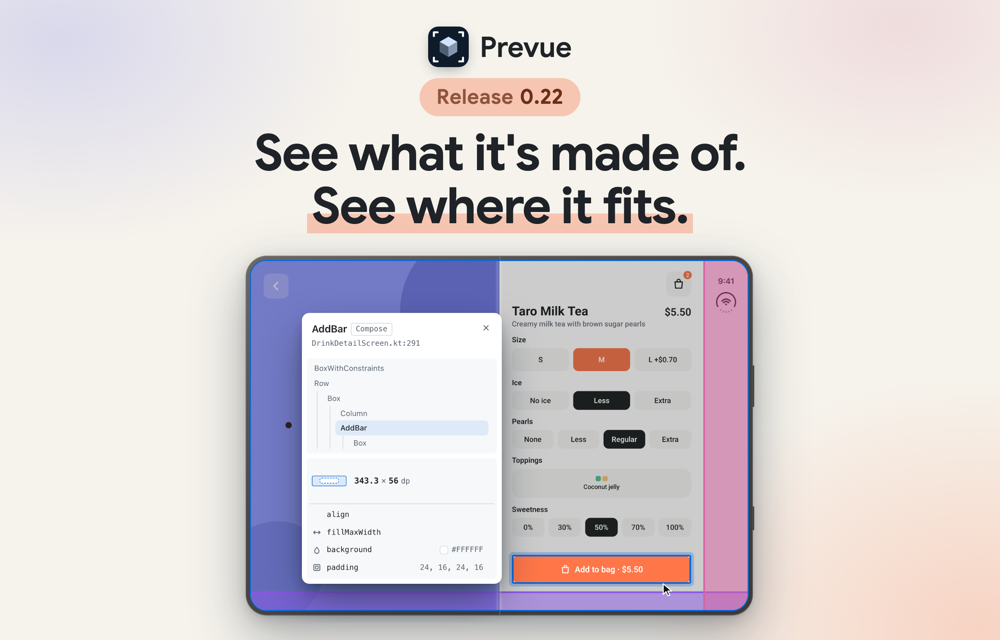

# Changelog

Only changes users can see go here.

> **A release is merging `develop` into `main`.** Each change goes under `[Unreleased]` in the PR that makes it (parallel PRs don't conflict — the file uses `merge=union`). Don't edit `plugin.json` by hand.
> To release, a version commit on `develop` bumps `plugin/VERSION` and `tools/sync-version.sh` carries it to both `plugin.json` files, the badges in both READMEs (English · Korean), and the heading in this file. Then one `develop` → `main` PR runs the "빌드 검증" (build check) workflow.
> The marketplace reads the plugin from `main`, so merging is shipping, and `version` in `plugin.json` is the switch ([docs](https://code.claude.com/docs/en/plugins-reference): *"users only receive updates when you bump it"*). Tags and GitHub Releases are created afterwards by running the release workflow by hand.

## [Unreleased]

Point at an element and a card beside the picture tells you what it is — its composable, size, modifiers and the elements around it — on a device that now delivers its real insets to your Composable and draws its own status bar, camera and gesture handle in the browser. Around that, the single view's controls move into one dock under the picture, board cards sit flat with their names above them, opening a file draws the code that changed while the daemon was off, and the first start after this update downloads about 11 MB once.

### Pointing

- **Pointing at an element opens a card beside the picture with its size, modifiers and the elements around it.** Clicking an element used to show only a small tag on the picture (`Card.kt:42 · ✓ copied`, plus a tab icon) that covered part of the preview, with the composable's ancestors only in its tooltip. Now a card stands just outside the picture, level with its top: the composable's name with where it is defined (its module, or `Compose` for a built-in), the call site's `file:line`, its size in dp and its modifier chain in the order applied (`fillMaxWidth`, `padding 12, 10, 12, 12`, `background #0E6B4F` …), read from the render without a Gradle build. A small tree shows its ancestors, siblings and children; hovering a row lights that element on the picture, and clicking it points at it exactly as clicking the picture does, so `prevue selection` and the clipboard follow. When a `@Preview` in the project calls the composable directly, a button in the card's header jumps to that preview on its file's board (several previews open a list). The mention still goes to the clipboard on its own; the card only speaks up when copying was blocked, with "Not copied · click to copy". While the mouse is over a picture, every element you can point at gets a faint outline. Esc, the close button, a click on an empty spot or a new picture of that preview closes the card — in the single view the first Esc closes the card and the second goes back to the board, and an ⌥-click on an empty spot also closes it. The card fades in while growing slightly from its corner next to the picture, and closes the same way a little faster; pointing at the same picture again while it closes brings it straight back. With reduced motion it only fades. On a board the card may cover the neighbouring preview. The README's pointing section shows it in a short clip.
- **The agent can find a composable's previews by its name.** Asked to show a composable it only knows by name, the agent used to search the repository for a file and ask you to pick when several matched. Now `prevue previews --of <composable>` lists the `@Preview` functions whose body calls that composable directly, with their FQNs to pass to `prevue show`, and where a composable of that name is defined. The name is matched exactly; a qualified name counts by its last part. A preview that reaches it through a shared wrapper isn't found, and when two composables in different packages share the name, the agent shows you their paths and lets you choose. It needs the preview server running; otherwise the agent opens the file as before.

### Devices

Interactive device previews now hand your Composable the insets of the real device, so `safeDrawingPadding()`, `statusBarsPadding()` and the rest move your content as they would there, and the browser draws that device's system UI on top. Pick a device in the dock to get both; there's nothing to turn on. The README's device clip is redrawn with the new dock and ends on Show inset areas.

- **Interactive device previews always show system UI and always deliver the device's insets to your Composable.** Whether content draws under the bars or stays inside them is up to your Modifiers, as on a real device. Inset values come from [windowinsets.info](https://windowinsets.info/) for Android and [safearea.info](https://safearea.info/) for iOS; `status.deviceInsets` reports the delivered values, the posture whose data was used and the source.
- **A "Show inset areas" toggle in the device dock draws the insets your Composable receives over the preview.** An icon toggle next to zoom draws a translucent band per inset type (`statusBars`, `navigationBars`, `captionBar`, `displayCutout`, `systemOverlays`), each in its own colour, so you can see what your content runs under. Outside the device body, each band gets a dimension line and a dp badge (top and bottom bands on the right, left and right bands below), drawn in the same neutral style as the width and height ruler with a dot in the band's colour, and with one lane per type so two types on the same edge never cover each other. The `safeDrawing` area inside them is filled light green and labelled "SAFE AREA" with its width × height in dp on a floating label that follows the light and dark theme. Types that are 0 in the current posture aren't drawn. It starts off, stays on through device, fold, orientation changes and saves on the same card, and turns off when you leave the single view or switch tabs. It's drawn in the browser only: rendered PNGs, the CLI and `status` don't change. Rounded corners and camera holes aren't drawn.
- **Android devices draw a Material status bar and gesture handle that line up with the camera.** When you pick a Galaxy or Pixel device, the viewer draws one shared status bar — the clock on the left, and Wi-Fi, signal and battery on the right — and a gesture handle, at the bar heights from windowinsets.info. The clock and icons are centred on the camera hole when it's in the top band, and on the band otherwise, and they grow with the band's height up to 1.3×, so tall status areas like Pixel 9's (65.9dp) don't look empty underneath. In landscape the status bar moves inward past a side camera cutout. The cameras on Pixel 9, Pixel 9 Pro Fold, Galaxy S26 and the Fold8 and Fold8 Ultra covers sit at the centre of the cutout windowinsets.info measured, and the Pixel cameras use its size. `status.systemUi.bars` reports `pixel` or `oneui` with the bar heights.
- **iPhones draw an iOS status bar, and iPhone Duo its own status display, in every orientation.** On iPhone 17, iPhone Air and iPhone 17 Pro Max the clock, signal bars, three-band Wi-Fi fan and battery match iOS in shape, size and position, and sit level with the Dynamic Island, which moved to its real size and height (lower on iPhone Air). iPhone Duo uses its compact clock and circular status indicator beside the content on the cover and in inner landscape, and above the content in inner portrait.
- **Device system UI is drawn in the browser only.** Device PNGs contain no system bars, and the insets your Composable receives are the same whether you look at the bars or not. Previews without a device (board, original, preset and custom sizes) use the renderer's default bars, below.
- **Previews with `@Preview(showSystemUi = true)` show the status bar and navigation bar.** They used to be drawn at the device's full size but with no bars at all, on the board and in the single view, so you couldn't see whether a screen ran under the status bar. Now the renderer draws Android's status bar (time, cutout, Wi-Fi and battery) and gesture handle on those cards. Apps targeting SDK 35 or later are edge-to-edge, so the bars sit over the app as on a device, and `statusBarsPadding()` and other insets move the content as they would there.
- **Non-device previews can turn the system bars on or off without touching the source.** A System UI button in the dock starts from the card's `showSystemUi` and looks pressed while the bars are on. Clicking it draws or removes the bars for that card's single view only: the choice survives saves, is kept when you change the size, and goes back to the annotation when you return to the board or switch tabs. The agent can do the same with `prevue focus <index> --system-ui on|off`, or `annotated` to go back to the source, and `status` reports `systemUi` (`choice`, the source's `annotated` value, and whether the bars are `shown`).
- **All devices offer Portrait, Landscape left and Landscape right in an orientation menu.** The CLI adds `focus --orientation portrait|landscape-left|landscape-right`; `--landscape` keeps its meaning. Landscape left is the same physical turn on every phone and folded cover: the top of the screen points left. The names follow Android, not Apple's `UIInterfaceOrientation`, so on iPhone our Landscape left is the posture safearea.info calls Landscape Right. On the iPhone Duo cover, Landscape left delivers `left = 84` and Landscape right `right = 84`, and the camera hole stays where the turn leaves it, at the spot and size (37pt) safearea.info gives. The inner Duo screen delivers `right = 84` in both landscapes, which is what safearea.info lists for both.
- **Folding and unfolding on iPhone Duo, Galaxy Z Fold8, Fold8 Ultra and Pixel Fold keep the device turned the way you hold it.** On iPhone Duo and Fold8, whose inner screen is landscape by default, the portrait cover opens to the landscape inner screen and the Landscape right cover opens to the portrait inner screen, with no extra 90° turn. Cover Landscape left and inner Landscape right have no upright partner, so they fold without a turn and land on Portrait. Fold8 Ultra and Pixel Fold keep the selected orientation. `--orientation` and `--landscape` on the command line are unchanged. Reduced motion keeps the existing fade.
- **iPhone Duo uses the Xcode 27.1 screen dimensions.** Its inner display now renders at 2853×2007px in landscape and 2007×2853px in portrait, with a matching device frame.

### Single view and board

- **The single view's controls moved from the side panel into one dock under the picture, so the preview gets the whole window.** The right-hand panel used to take 264 px beside the stage and stack every size, all ten devices, the posture buttons and the zoom bar in one long column, which also squeezed the picture in narrow windows. Now a single dock floats at the bottom centre of the stage. On its left, a button names what you picked, such as `@Preview`, `320×640`, Custom, or a device with its outline. Clicking it opens the list of sizes and devices above the dock; picking one closes it, and Esc or a click elsewhere closes it too. In the middle, the dock shows only what fits your choice: Rotate, Fold and Hinge line buttons for a device, or the width and height sliders for Custom; `@Preview` and the presets show nothing there. Next to zoom sits a System UI button for sizes other than a device, or the Show inset areas toggle on a device. These buttons are icons whose picture shows the state — the phone tilts to the current orientation, Fold and Unfold have their own arrows, and Hinge line and System UI look pressed when on. Hover a button for its name and current state; screen readers read the same name. Zoom (− · % · + · Fit) sits at the right end, and its menu opens upward. At fit, the device leaves room for the dock, and the dock moves up when a notice appears below. Below 560 px a device button shows just its outline and zoom keeps only its percentage (+ and − still work from the keyboard).
- **Opening a card brings the picture first and the controls after it.** When you open a card from the board, the header's back button and preview name used to slide in the moment the picture started growing, ahead of everything else. Now they fade in with the dock and the device body as the picture lands, and on the way back they leave first, before the picture shrinks. Esc and the browser's back button work right away, even before the header shows. With reduced motion, or when the card is off screen, nothing waits.
- **A preview opened by its FQN sits on its file's board, so the back button and Esc always lead back.** `prevue show` with a function's FQN used to open that preview alone with nothing under it: the viewer showed a View | Interact switch instead of a back button, and once you switched to Interact, Esc did nothing and there was no way out but opening another file. Now it opens that function's file as a board tab (or switches to the tab if it is already open) and enters that card in interactive mode, as if you had pressed its ▶ Interactive. The back button and Esc return to that card on the board, and the other cards are drawn beside it once input has been quiet for a second. The agent's answer is still that one card, though it now takes as long as opening the card with ▶, since an interactive card gets its own class loader (about 0.7 s to draw on the pearl sample's filter screen, up from about 0.1 s for the old still picture). `--index` picks which of the function's cards when it makes several (a multipreview annotation or `@PreviewParameter`), and `prevue focus <index> --off` goes back to the board. An FQN whose source file can't be found (a preview that is not a top-level function) is now refused with "Couldn't find the source file of … — show the file path instead"; it used to be drawn alone without its `@Preview` arguments. `status` tabs no longer carry `fqn`, since every tab is a file. The shortcut list (`?`) now shows Esc and I on one row as the way back to the board, since a single view has no View mode to switch to.
- **Other cards on the board stay current while you interact with one.** After a save in interactive mode, the other cards used to keep their old pictures until you went back to the board, which then redrew them while you watched, and `prevue card` on another card answered `skipped`. Now, once input has been quiet for a second, Prevue redraws them one by one beside the interactive card without resetting it (after the other sizes and postures it already draws), so going back shows new pictures right away. Touching, resizing or saving again pauses it after the card in progress. `prevue card` on another card now draws it the same way, and `wait` still answers `complete:false` until every card is new.
- **A board card's name, settings and ▶ button sit above its picture.** On a tall card (a 360×780 dp phone's picture alone is about 650 px high) they used to sit under the picture, so you had to scroll down to see which variant it was or to open it in interactive mode. Hovering a card no longer shows the rendered pixel size, render time or "old image" — a card being redrawn after a save is just dimmed, and the preview's original arguments are still in the tooltip on its settings. A card with no name of its own keeps its ▶ on the settings row, and a group where no card has a name uses a single row, so the picture sits closer to the heading.
- **`@PreviewParameter` cards are named after their values.** A provider's cards used to be called `#0`, `#1`, … on the board, so you had to tell them apart by the picture. Now a card whose value is an enum, a number, a boolean, a character or a string of up to 24 characters on one line is called by that value's `toString()` (`FRUIT_TEA`, `MILK_TEA`, …), in the board, the single-preview title and the agent's `show` · `wait` answer (`paramLabel`). Other values, such as data classes, and values that share a name keep `#n`, which now also carries its `#` after a preview name (`dark · #2`, used to be `dark · 2`) so a number value is never read as a position.
- **Board cards and the single view's picture sit flat, outlined by a thin line.** They used to have rounded corners and a drop shadow, so the pictures floated above the page and a white or black app screen had only a faint shadow to set it apart. Now each picture has square corners and a 1 px border that darkens while you hover a card, and the single view in interactive mode keeps only its 2 px blue ring, which stays 2 px thick when you zoom in (it used to grow with the zoom). Opening a card and going back to the board now carry that border or ring across, with no shadow or rounded corners appearing in between. Pointing at an element lands on the same spot as before.
- **Going back to the board slides the picture under its group's heading.** When the top of a card sat under the board's pinned heading (the preview's name at the top of each group), leaving that card's single view used to shrink the picture over the heading, hiding the name until the motion ended. Now the shrinking frame passes under the heading, showing through its faded lower edge the way the card itself does, so the name stays readable the whole way.

### Starting and updating

- **The first start after this update asks to download once more.** Prevue now assembles its daemon with Metro, a compile-time dependency injection library, so the daemon build that runs once after an update needs about 11 MB it did not need before. It used to rebuild silently from what was already downloaded; this once, `health` answers with `missing: ["toolchain"]` and `prevue setup` fetches it (that build also lays down a new `~/.prevue/toolchain/lib-*` folder of about 118 MB next to the old one, which a `prevue paths` entry says you can delete). The daemon build now runs on the same Java 21+ that the daemon uses, even when the shell's `JAVA_HOME` points at Java 17. Previews are drawn exactly as before.
- **Opening a file draws the current code of files that changed while the daemon was off.** When the daemon starts, it notes the sources edited since the last Gradle build (after a `git pull`, a branch switch or an edit with no daemon running). Opening a file used to compile at most that file and leave the others for the next save, so a file it calls was drawn from its old build output in the meantime, with no stale notice. For example, a screen whose `safeDrawingPadding()` came after the build looked as if the device insets were 0. Now opening a file compiles those sources together with it before the first picture. This applies when the daemon noted 64 or fewer of them; with more it notes none, and each one is compiled when you save it, as before. A `--no-watch` daemon doesn't note them. A noted source that fails to compile on its own error is left out so the rest still draws, and that file stays on its old build output until you fix and save it. A file you open while such a source is still being noted waits for it, so the first picture can't miss it. That first open takes one extra compile. On the Pearl fixture the first picture of a cold `start --show` comes in about 4.1 s with none of them, 4.5 s with one, and 8.5 to 9.9 s with all 25 sources across six modules. When the file you open is itself one of them, the renderer warms up on its old build output during that compile; that first picture comes in about 4.2 s.
- **A restarted daemon reuses what the previous one compiled, so its first picture doesn't wait for those compiles again.** After a restart, including an idle shutdown, the daemon keeps the previous daemon's compiled classes and draws with them when nothing changed since. On the Pearl fixture, with the same 25 sources across six modules, the first picture of a cold `start --show` comes in about 2.8 s. It throws all of them away and compiles as above when one of those sources was changed or deleted since it was last compiled (a save that only changed a literal or failed to compile counts), when one sits outside its module's source folders (a `--watch` copy), when Gradle's build time of a module is unknown, or when Prevue, the compiler, the Compose plugin, `android.jar` or a module's compile arguments changed. A module that Gradle rebuilt since is dropped on its own and drawn from Gradle's output.

### Fixes

- **Saving a commonMain file of a Kotlin Multiplatform library module redraws when the module's dependencies are `implementation`.** Hot reload used to compile such a module against the app's compile classpath, which lacks the module's own `implementation` dependencies (other project modules, `ui-tooling-preview`, `foundation`), so every save failed with "Unresolved reference" ([#129](https://github.com/kakao/prevue/issues/129)). Now warmup records each KMP module's own Android compile classpath and saving compiles against it. A KMP module of an included build, a project dependency declared only with `compileOnly` or in a custom intermediate source set such as `mobileMain`, and a configuration that merges several flavors still go the old way. Warm up once more to pick it up. Thanks to @citytexi for the report and the fix ([#130](https://github.com/kakao/prevue/pull/130)).
- **The `next` and `then` commands in a response start with the `prevue` that answered.** When you called a `prevue` other than the one on `PATH` (a checkout's `plugin/bin/prevue`, or a Codex install, which runs the plugin's `bin/prevue` by path), `next` used to say `prevue start …`, so running it as is started the daemon with whichever `prevue` was on `PATH`, or failed when there was none. Now `next` and `then` begin with the full path of the `prevue` that answered in that case. When the `prevue` on `PATH` is the one that answered, as with a Claude Code install, they still begin with `prevue`.
- Returning to Original size after rendering at a different size restores the preview's own aspect ratio.

### Thanks

@citytexi ([#129](https://github.com/kakao/prevue/issues/129), [#130](https://github.com/kakao/prevue/pull/130))

---

### 한국어

요소를 가리키면 그림 옆에 카드가 떠서 그것이 무엇인지 알려 줍니다. 컴포저블과 크기, Modifier, 주변 요소까지 보여 주고, 이 모든 일이 기기 위에서 일어납니다. 기기는 이제 실제 인셋을 Composable에 전달하고, 자기 상태 표시줄과 카메라, 제스처 핸들을 브라우저에 그립니다. 그 밖에 한 장 보기의 조작이 그림 아래 독 하나로 모였고, 보드 카드는 이름을 그림 위에 둔 평평한 모양이 됐습니다. 파일을 열면 데몬이 꺼져 있던 동안 바뀐 코드로 그리고, 업데이트 뒤 첫 시작에서 약 11 MB를 한 번 받습니다.

#### 가리키기

- **요소를 가리키면 그림 옆에 카드가 열려 크기와 Modifier, 주변 요소를 보여 줍니다.** 예전에는 요소를 누르면 그림 위에 작은 꼬리표(`Card.kt:42 · ✓ copied`와 탭 아이콘)만 떠서 프리뷰 일부를 가렸고, 조상 컴포저블은 툴팁에서만 볼 수 있었습니다. 이제는 그림 바로 바깥, 그림 윗변과 같은 높이에 카드가 섭니다. 카드에는 컴포저블 이름과 정의된 곳(모듈, 기본 컴포저블이면 `Compose`), 호출한 자리의 `file:line`, dp 단위 크기, 적용 순서대로의 Modifier 체인(`fillMaxWidth`, `padding 12, 10, 12, 12`, `background #0E6B4F` …)이 나옵니다. 모두 Gradle 빌드 없이 렌더에서 읽은 값입니다. 작은 트리가 조상과 형제, 자식을 보여 줍니다. 행에 마우스를 올리면 그림에서 그 요소가 밝아지고, 행을 누르면 그림을 누른 것과 똑같이 그 요소를 가리킵니다. 그래서 `prevue selection`과 클립보드도 함께 바뀝니다. 프로젝트 안의 `@Preview`가 그 컴포저블을 직접 부르면, 카드 머리의 버튼으로 그 파일 보드의 해당 프리뷰로 건너갑니다(프리뷰가 여럿이면 목록이 열립니다). 멘션은 예전처럼 저절로 클립보드에 들어가고, 카드는 복사가 막혔을 때만 "Not copied · click to copy"로 알립니다. 마우스가 그림 위에 있으면 가리킬 수 있는 요소마다 옅은 윤곽이 생깁니다. 카드는 Esc나 닫기 버튼, 빈 곳 클릭, 그 프리뷰의 새 그림으로 닫힙니다. 한 장 보기에서는 첫 Esc가 카드를 닫고 두 번째 Esc가 보드로 돌아가며, 빈 곳을 ⌥-클릭해도 닫힙니다. 카드는 그림 쪽 모서리에서 살짝 커지며 나타나고, 같은 모양으로 조금 더 빨리 닫힙니다. 닫히는 중에 같은 그림을 다시 가리키면 바로 돌아옵니다. 움직임 줄이기를 켜면 흐려짐만 남습니다. 보드에서는 카드가 이웃 프리뷰를 가릴 수 있습니다. README의 가리키기 절에서 짧은 영상으로 볼 수 있습니다.
- **에이전트가 컴포저블 이름으로 그 프리뷰를 찾습니다.** 이름만 아는 컴포저블을 보여 달라고 하면, 예전에는 에이전트가 저장소에서 파일을 찾고 여럿이 맞으면 사람에게 골라 달라고 했습니다. 이제 `prevue previews --of <composable>`이 본문에서 그 컴포저블을 직접 부르는 `@Preview` 함수를 `prevue show`에 넘길 FQN과 함께 내고, 그 이름의 컴포저블이 정의된 곳도 알려 줍니다. 이름은 정확히 맞아야 하고, 한정된 이름은 마지막 부분으로 셉니다. 공용 래퍼를 거쳐 부르는 프리뷰는 찾지 못합니다. 다른 패키지의 두 컴포저블이 이름이 같으면 에이전트가 두 경로를 보여 주고 고르게 합니다. 프리뷰 서버가 떠 있어야 하고, 없으면 에이전트는 예전처럼 파일을 엽니다.

#### 기기

인터랙티브 기기 프리뷰가 이제 실제 기기의 인셋을 Composable에 넘깁니다. 그래서 `safeDrawingPadding()`, `statusBarsPadding()` 같은 Modifier가 실기기에서처럼 내용을 옮기고, 그 위에 브라우저가 그 기기의 시스템 UI를 그립니다. 독에서 기기를 고르기만 하면 둘 다 적용되고, 따로 켤 것은 없습니다. README의 기기 영상도 새 독으로 다시 찍었고, 인셋 영역 보기를 켜는 장면으로 끝납니다.

- **인터랙티브 기기 프리뷰는 늘 시스템 UI를 보여 주고 늘 기기 인셋을 Composable에 넘깁니다.** 내용이 바 밑까지 그려질지 바 안쪽에 머물지는 실기기에서처럼 Modifier가 정합니다. 인셋 값은 Android는 [windowinsets.info](https://windowinsets.info/), iOS는 [safearea.info](https://safearea.info/)에서 가져옵니다. `status.deviceInsets`가 넘긴 값과 어느 자세의 자료를 썼는지, 그리고 출처를 알려 줍니다.
- **기기 독의 "Show inset areas" 토글이 Composable이 받는 인셋을 프리뷰 위에 그립니다.** 확대 옆 아이콘 토글을 켜면 인셋 종류(`statusBars`, `navigationBars`, `captionBar`, `displayCutout`, `systemOverlays`)마다 다른 색의 반투명 띠가 그려져, 내용이 무엇 밑으로 들어가는지 보입니다. 기기 몸체 바깥에는 띠마다 치수선과 dp 배지가 붙습니다. 위아래 띠는 오른쪽에, 좌우 띠는 아래쪽에 붙고, 너비·높이 눈금자와 같은 무채색에 띠 색 점을 찍어 그립니다. 종류마다 줄을 따로 써서 같은 변의 두 종류가 서로 가리지 않습니다. 그 안쪽의 `safeDrawing` 영역은 연한 초록으로 칠하고, 밝은 테마와 어두운 테마를 따르는 떠 있는 라벨에 "SAFE AREA"와 dp 단위 너비 × 높이를 적습니다. 지금 자세에서 0인 종류는 그리지 않습니다. 처음에는 꺼져 있습니다. 같은 카드에서는 기기, 접기, 방향을 바꾸거나 저장해도 켜진 채로 남고, 한 장 보기를 떠나거나 탭을 바꾸면 꺼집니다. 브라우저에만 그리므로 렌더된 PNG와 CLI, `status`는 바뀌지 않습니다. 둥근 모서리와 카메라 구멍은 그리지 않습니다.
- **Android 기기는 카메라에 맞춘 Material 상태 표시줄과 제스처 핸들을 그립니다.** Galaxy나 Pixel 기기를 고르면 뷰어가 공통 상태 표시줄(왼쪽에 시계, 오른쪽에 Wi-Fi·신호·배터리)과 제스처 핸들을 windowinsets.info의 바 높이로 그립니다. 시계와 아이콘은 카메라 구멍이 위쪽 띠에 있으면 구멍에, 아니면 띠에 가운데를 맞추고, 띠 높이에 따라 1.3배까지 커집니다. 그래서 Pixel 9(65.9dp)처럼 높은 상태 영역도 아래가 비어 보이지 않습니다. 가로에서는 옆 카메라 컷아웃을 피해 상태 표시줄이 안쪽으로 들어갑니다. Pixel 9, Pixel 9 Pro Fold, Galaxy S26, Fold8·Fold8 Ultra 커버의 카메라는 windowinsets.info가 잰 컷아웃 가운데에 놓이고, Pixel 카메라는 그 크기를 씁니다. `status.systemUi.bars`는 `pixel`이나 `oneui`와 바 높이를 알려 줍니다.
- **iPhone은 iOS 상태 표시줄을, iPhone Duo는 자기 상태 표시를 모든 방향에서 그립니다.** iPhone 17, iPhone Air, iPhone 17 Pro Max의 시계, 신호 막대, 세 겹 Wi-Fi 부채꼴, 배터리가 모양과 크기, 위치까지 iOS와 같고, Dynamic Island와 높이를 맞춥니다. Dynamic Island도 실제 크기와 높이로 옮겼습니다(iPhone Air는 더 낮습니다). iPhone Duo는 커버와 펼친 가로에서 작은 시계와 원형 상태 표시를 내용 옆에 두고, 펼친 세로에서는 내용 위에 둡니다.
- **기기 시스템 UI는 브라우저에만 그립니다.** 기기 PNG에는 시스템 바가 없고, Composable이 받는 인셋은 바를 보든 안 보든 같습니다. 기기가 아닌 프리뷰(보드, Original, 프리셋, 사용자 크기)는 아래처럼 렌더러의 기본 바를 씁니다.
- **`@Preview(showSystemUi = true)` 프리뷰에 상태 표시줄과 내비게이션 바가 보입니다.** 예전에는 보드와 한 장 보기 모두에서 기기 전체 크기로 그리면서도 바가 전혀 없어, 화면이 상태 표시줄 밑으로 들어가는지 알 수 없었습니다. 이제 이런 카드에는 렌더러가 Android 상태 표시줄(시간, 컷아웃, Wi-Fi, 배터리)과 제스처 핸들을 그립니다. SDK 35 이상을 타기팅하는 앱은 edge-to-edge라서 바가 기기에서처럼 앱 위에 놓이고, `statusBarsPadding()` 같은 인셋이 기기에서처럼 내용을 옮깁니다.
- **기기가 아닌 프리뷰는 소스를 고치지 않고 시스템 바를 켜고 끌 수 있습니다.** 독의 System UI 버튼은 카드의 `showSystemUi`에서 시작하고, 바가 켜져 있으면 눌린 모양입니다. 누르면 그 카드의 한 장 보기에서만 바를 그리거나 지웁니다. 이 선택은 저장해도 남고 크기를 바꿔도 유지되며, 보드로 돌아가거나 탭을 바꾸면 애노테이션 값으로 돌아갑니다. 에이전트도 `prevue focus <index> --system-ui on|off`로 똑같이 할 수 있고, `annotated`로 소스 값에 돌아갑니다. `status`는 `systemUi`(`choice`, 소스의 `annotated` 값, 바가 보이는지 `shown`)를 알려 줍니다.
- **모든 기기의 방향 메뉴에 Portrait, Landscape left, Landscape right가 있습니다.** CLI에는 `focus --orientation portrait|landscape-left|landscape-right`가 생겼고, `--landscape`는 뜻이 그대로입니다. Landscape left는 모든 폰과 접은 커버에서 같은 실제 회전, 곧 화면 위쪽이 왼쪽을 향하는 방향입니다. 이름은 Apple의 `UIInterfaceOrientation`이 아니라 Android를 따릅니다. 그래서 iPhone에서 우리의 Landscape left는 safearea.info가 Landscape Right라고 부르는 자세입니다. iPhone Duo 커버에서는 Landscape left가 `left = 84`, Landscape right가 `right = 84`를 넘기고, 카메라 구멍은 회전이 끝난 자리에 safearea.info가 주는 위치와 크기(37pt)로 남습니다. 펼친 Duo 화면은 두 가로 모두 `right = 84`를 넘기는데, safearea.info가 두 방향 모두 그렇게 적고 있습니다.
- **iPhone Duo, Galaxy Z Fold8, Fold8 Ultra, Pixel Fold를 접고 펼쳐도 손에 든 방향이 그대로입니다.** 펼친 화면이 원래 가로인 iPhone Duo와 Fold8에서는 세로 커버가 가로 펼친 화면으로, Landscape right 커버가 세로 펼친 화면으로 열리고, 90° 회전이 따로 끼지 않습니다. 커버 Landscape left와 펼친 Landscape right는 똑바로 선 짝이 없어서 회전 없이 접히고 Portrait로 갑니다. Fold8 Ultra와 Pixel Fold는 고른 방향을 유지합니다. 명령줄의 `--orientation`과 `--landscape`는 바뀌지 않았습니다. 움직임 줄이기에서는 기존 흐려짐을 씁니다.
- **iPhone Duo가 Xcode 27.1의 화면 크기를 씁니다.** 펼친 화면은 가로 2853×2007px, 세로 2007×2853px로 그리고, 기기 틀도 그에 맞춥니다.

#### 한 장 보기와 보드

- **한 장 보기의 조작이 옆 패널에서 그림 아래 독 하나로 옮겨 와, 프리뷰가 창 전체를 씁니다.** 예전에는 오른쪽 패널이 무대 옆 264 px를 차지하고 모든 크기와 기기 열 개, 자세 버튼, 확대 막대를 한 줄로 길게 쌓아, 좁은 창에서는 그림까지 눌렸습니다. 이제는 독 하나가 무대 아래 가운데에 떠 있습니다. 왼쪽 버튼에는 고른 것의 이름(`@Preview`, `320×640`, Custom, 또는 윤곽을 곁들인 기기)이 나옵니다. 누르면 독 위로 크기·기기 목록이 열리고, 하나를 고르면 닫힙니다. Esc나 다른 곳 클릭으로도 닫힙니다. 가운데에는 고른 것에 맞는 조작만 나옵니다. 기기면 Rotate, Fold, Hinge line 버튼, Custom이면 너비·높이 슬라이더이고, `@Preview`와 프리셋은 비어 있습니다. 확대 옆에는 기기가 아닌 크기면 System UI 버튼이, 기기면 Show inset areas 토글이 있습니다. 이 버튼들은 그림으로 상태를 보여 주는 아이콘입니다. 폰이 지금 방향으로 기울고, Fold와 Unfold는 각자의 화살표를 가지며, Hinge line과 System UI는 켜지면 눌린 모양입니다. 버튼에 마우스를 올리면 이름과 지금 상태가 나오고, 화면 낭독기도 같은 이름을 읽습니다. 확대(− · % · + · Fit)는 오른쪽 끝에 있고 메뉴가 위로 열립니다. 화면 맞춤에서는 기기가 독 자리를 비켜 주고, 아래에 알림이 뜨면 독이 위로 올라갑니다. 560 px보다 좁으면 기기 버튼은 윤곽만, 확대는 배율만 남습니다(+와 −는 키보드로 계속 쓸 수 있습니다).
- **카드를 열면 그림이 먼저 오고 조작은 그 뒤에 옵니다.** 예전에는 보드에서 카드를 열면 그림이 커지기 시작하는 순간 헤더의 뒤로 버튼과 프리뷰 이름이 다른 것보다 먼저 미끄러져 들어왔습니다. 이제는 그림이 자리 잡을 때 독, 기기 몸체와 함께 흐려짐으로 들어오고, 돌아갈 때는 그림이 줄어들기 전에 먼저 물러납니다. Esc와 브라우저 뒤로 가기는 헤더가 보이기 전에도 바로 됩니다. 움직임 줄이기를 켰거나 카드가 화면 밖에 있으면 기다리지 않습니다.
- **FQN으로 연 프리뷰가 그 파일의 보드 위에 놓여, 뒤로 버튼과 Esc가 늘 돌아갈 곳이 있습니다.** 예전에는 `prevue show`에 함수 FQN을 주면 그 프리뷰만 밑에 아무것도 없이 열렸습니다. 뷰어는 뒤로 버튼 대신 View | Interact 전환을 보여 줬고, Interact로 바꾼 뒤에는 Esc가 듣지 않아 다른 파일을 여는 것 말고는 나갈 길이 없었습니다. 이제는 그 함수의 파일을 보드 탭으로 열고(이미 열려 있으면 그 탭으로 바꾸고), ▶ Interactive를 누른 것처럼 그 카드를 인터랙티브 모드로 엽니다. 뒤로 버튼과 Esc는 보드의 그 카드로 돌아가고, 입력이 1초 잠잠하면 다른 카드들이 옆에서 그려집니다. 에이전트가 받는 답은 여전히 그 카드 하나입니다. 다만 인터랙티브 카드는 자기 클래스 로더를 가지므로 ▶로 여는 것만큼 걸립니다(pearl 샘플의 필터 화면에서 그리는 데 약 0.7초, 예전 정지 그림은 약 0.1초). 함수가 카드를 여러 장 만들면(멀티프리뷰 애노테이션이나 `@PreviewParameter`) `--index`로 고르고, `prevue focus <index> --off`로 보드에 돌아갑니다. 소스 파일을 찾을 수 없는 FQN(최상위 함수가 아닌 프리뷰)은 이제 "Couldn't find the source file of … — show the file path instead"로 거절합니다. 예전에는 `@Preview` 인자 없이 혼자 그려졌습니다. 모든 탭이 파일이 됐으므로 `status`의 탭에는 이제 `fqn`이 없습니다. 한 장 보기에는 바꿀 View 모드가 없어서, 단축키 표(`?`)는 Esc와 I를 보드로 돌아가는 한 줄로 보여 줍니다.
- **한 카드를 조작하는 동안에도 보드의 다른 카드가 최신으로 유지됩니다.** 예전에는 인터랙티브 모드에서 저장하면 다른 카드들이 보드로 돌아갈 때까지 옛 그림이었다가, 돌아가는 순간 눈앞에서 다시 그려졌습니다. 다른 카드에 `prevue card`를 하면 `skipped`가 돌아왔습니다. 이제는 입력이 1초 잠잠하면 Prevue가 인터랙티브 카드를 초기화하지 않고 옆에서 다른 카드를 하나씩 다시 그립니다(이미 그리고 있던 다른 크기와 자세 다음에). 그래서 돌아가면 새 그림이 바로 보입니다. 터치하거나 크기를 바꾸거나 다시 저장하면, 그리던 카드까지만 그리고 멈춥니다. 다른 카드에 `prevue card`를 하면 이제 같은 방식으로 그리고, `wait`는 모든 카드가 새것이 될 때까지 여전히 `complete:false`를 답합니다.
- **보드 카드의 이름과 설정, ▶ 버튼이 그림 위에 있습니다.** 키 큰 카드(360×780 dp 폰은 그림만 약 650 px)에서는 예전에 이것들이 그림 아래에 있어서, 어느 변형인지 보거나 인터랙티브 모드로 열려면 아래로 스크롤해야 했습니다. 카드에 마우스를 올려도 이제 렌더 픽셀 크기, 렌더 시간, "old image"가 나오지 않습니다. 저장 뒤 다시 그리는 카드는 흐려지기만 하고, 프리뷰의 원래 인자는 설정의 툴팁에 그대로 있습니다. 자기 이름이 없는 카드는 ▶를 설정 줄에 두고, 이름 있는 카드가 하나도 없는 묶음은 한 줄만 써서 그림이 머리에 더 가까워집니다.
- **`@PreviewParameter` 카드가 값의 이름으로 불립니다.** 예전에는 제공자의 카드가 보드에서 `#0`, `#1`, …로 불려 그림으로 구분해야 했습니다. 이제 값이 enum, 숫자, boolean, 문자, 또는 한 줄 24자 이하 문자열이면 그 값의 `toString()`(`FRUIT_TEA`, `MILK_TEA`, …)으로 부릅니다. 보드와 한 장 보기 제목, 에이전트의 `show` · `wait` 답(`paramLabel`)에 모두 적용됩니다. data class 같은 다른 값과 이름이 겹치는 값은 `#n`을 유지합니다. 이제 프리뷰 이름 뒤에서도 `#`를 붙여(`dark · #2`, 예전에는 `dark · 2`) 숫자 값을 위치로 읽지 않게 합니다.
- **보드 카드와 한 장 보기의 그림이 가는 선으로 테두리를 두른 평평한 모양입니다.** 예전에는 둥근 모서리와 그림자가 있어 그림이 페이지 위에 떠 있었고, 흰색이나 검은색 앱 화면은 옅은 그림자 말고는 배경과 구분되지 않았습니다. 이제 그림마다 모서리가 각지고 1 px 테두리가 있으며, 카드에 마우스를 올리면 테두리가 짙어집니다. 인터랙티브 모드의 한 장 보기에는 2 px 파란 테두리만 남고, 확대해도 2 px 굵기를 유지합니다(예전에는 확대와 함께 굵어졌습니다). 카드를 열고 보드로 돌아갈 때도 그 테두리가 그대로 이어지고, 중간에 그림자나 둥근 모서리가 나타나지 않습니다. 요소를 가리키는 자리는 예전과 같습니다.
- **보드로 돌아갈 때 그림이 묶음 머리 밑으로 미끄러져 들어갑니다.** 카드 위쪽이 보드에 고정된 머리(묶음마다 위에 있는 프리뷰 이름) 밑에 있으면, 예전에는 한 장 보기를 떠날 때 줄어드는 그림이 머리를 덮어 움직임이 끝날 때까지 이름이 가려졌습니다. 이제 줄어드는 틀이 카드처럼 머리 밑으로 지나가며 머리의 흐린 아래 가장자리로 비쳐 보이므로, 이름이 끝까지 읽힙니다.

#### 시작과 업데이트

- **업데이트 뒤 첫 시작에서 한 번 더 내려받기를 묻습니다.** Prevue가 이제 컴파일 타임 의존성 주입 라이브러리인 Metro로 데몬을 조립합니다. 그래서 업데이트 뒤 한 번 도는 데몬 빌드에 예전에 없던 약 11 MB가 필요합니다. 예전에는 이미 받은 것으로 조용히 다시 빌드했지만, 이번 한 번은 `health`가 `missing: ["toolchain"]`을 답하고 `prevue setup`이 그것을 받습니다. 이 빌드는 옛 폴더 옆에 약 118 MB짜리 새 `~/.prevue/toolchain/lib-*` 폴더도 만들고, 옛 폴더는 지워도 된다고 `prevue paths` 항목이 알려 줍니다. 데몬 빌드는 이제 셸의 `JAVA_HOME`이 Java 17을 가리켜도 데몬과 같은 Java 21 이상에서 돕니다. 프리뷰는 예전과 똑같이 그려집니다.
- **파일을 열면 데몬이 꺼져 있던 동안 바뀐 파일의 지금 코드로 그립니다.** 데몬은 시작할 때 마지막 Gradle 빌드 뒤에 고친 소스를 적어 둡니다(`git pull`, 브랜치 전환, 데몬 없이 고친 뒤). 예전에는 파일을 열면 많아야 그 파일만 컴파일하고 나머지는 다음 저장까지 미뤄, 그 사이 그 파일이 부르는 파일은 옛 빌드 산출물로 그려졌고 옛 그림이라는 표시도 없었습니다. 예를 들어 빌드 뒤에 `safeDrawingPadding()`을 더한 화면은 기기 인셋이 0인 것처럼 보였습니다. 이제 파일을 열면 적어 둔 소스를 그 파일과 함께 컴파일한 뒤 첫 그림을 그립니다. 적어 둔 소스가 64개 이하일 때만 그렇습니다. 그보다 많으면 하나도 적지 않고, 예전처럼 저장할 때마다 그 파일을 컴파일합니다. `--no-watch` 데몬은 적지 않습니다. 적어 둔 소스가 자기 오류로 컴파일에 실패하면 그것만 빼고 나머지를 그리며, 그 파일은 고쳐서 저장할 때까지 옛 빌드 산출물로 남습니다. 소스를 아직 적는 중에 연 파일은 그것을 기다리므로, 첫 그림이 그 소스를 놓치지 않습니다. 첫 열기에는 컴파일이 한 번 더 듭니다. Pearl 픽스처에서 콜드 `start --show`의 첫 그림은 적어 둔 소스가 없으면 약 4.1초, 하나면 4.5초, 여섯 모듈에 걸친 25개 전부면 8.5~9.9초입니다. 연 파일이 그 소스 중 하나면 그 컴파일 동안 렌더러가 옛 빌드 산출물로 데워지고, 첫 그림은 약 4.2초입니다.
- **다시 띄운 데몬이 앞 데몬이 컴파일한 것을 이어 써서, 첫 그림이 그 컴파일을 다시 기다리지 않습니다.** 유휴 종료를 포함해 다시 시작하면, 데몬은 앞 데몬이 컴파일한 클래스를 간직했다가 그 뒤 바뀐 것이 없으면 그것으로 그립니다. Pearl 픽스처에서 같은 25개 소스(여섯 모듈)일 때 콜드 `start --show`의 첫 그림이 약 2.8초입니다. 다음 경우에는 전부 버리고 위처럼 컴파일합니다. 마지막 컴파일 뒤에 그 소스 중 하나가 바뀌거나 지워졌을 때(리터럴만 바꾼 저장이나 컴파일에 실패한 저장도 셉니다), 하나가 모듈의 소스 폴더 밖에 있을 때(`--watch` 복사본), 모듈의 Gradle 빌드 시각을 모를 때, Prevue나 컴파일러, Compose 플러그인, `android.jar`, 모듈의 컴파일 인자가 바뀌었을 때입니다. 그 사이 Gradle이 다시 빌드한 모듈은 그 모듈만 버리고 Gradle 산출물로 그립니다.

#### 고친 것

- **Kotlin Multiplatform 라이브러리 모듈의 의존이 `implementation`이어도 commonMain 파일을 저장하면 다시 그립니다.** 예전에는 핫 리로드가 이런 모듈을 앱의 컴파일 클래스패스로 컴파일했는데, 거기에는 그 모듈 자신의 `implementation` 의존(다른 프로젝트 모듈, `ui-tooling-preview`, `foundation`)이 없어서 저장할 때마다 "Unresolved reference"로 실패했습니다([#129](https://github.com/kakao/prevue/issues/129)). 이제 warmup이 KMP 모듈마다 그 모듈의 Android 컴파일 클래스패스를 기록하고, 저장하면 그것으로 컴파일합니다. included build의 KMP 모듈, `compileOnly`나 `mobileMain` 같은 사용자 중간 소스셋에서만 선언한 프로젝트 의존, 여러 flavor를 합친 구성은 예전 길로 갑니다. 적용하려면 warmup을 한 번 더 하세요. 제보하고 고쳐 준 @citytexi님께 감사드립니다([#130](https://github.com/kakao/prevue/pull/130)).
- **응답의 `next`와 `then` 명령이 답한 `prevue`로 시작합니다.** `PATH`에 있는 것과 다른 `prevue`(체크아웃의 `plugin/bin/prevue`, 또는 플러그인의 `bin/prevue`를 경로로 부르는 Codex 설치)를 부르면, 예전에는 `next`가 `prevue start …`라고 해서 그대로 치면 `PATH`에 있는 `prevue`로 데몬이 뜨거나, 없으면 실패했습니다. 이제 그런 경우 `next`와 `then`이 답한 `prevue`의 전체 경로로 시작합니다. Claude Code 설치처럼 `PATH`의 `prevue`가 답했으면 여전히 `prevue`로 시작합니다.
- 다른 크기로 렌더한 뒤 Original로 돌아오면 프리뷰 본래의 가로세로 비율로 돌아갑니다.

## [0.21.0] — 2026-11-02

Name a file in commonMain and its previews come up in the browser and redraw on save, the same way Android ones do — Kotlin Multiplatform and Compose Multiplatform modules work end to end. Prevue also gets going on a Mac without Android Studio, finding an installed JDK by itself and saying what is missing (Java or the Android SDK) before anything is approved, and saving stays under a second even when you pause between edits.

### Kotlin Multiplatform

Prevue now draws commonMain previews of Kotlin Multiplatform and Compose Multiplatform modules. Like Android Studio, it draws them from the module's Android compilation, and iOS · web targets alongside are fine. It takes AGP 9's `com.android.kotlin.multiplatform.library` (variant `androidMain`) and the older `kotlin.multiplatform` + `com.android.library` pair. If you warmed up an app module with an earlier version, warm it up once more to pick all of this up.

`PartyAnimationPreview` from the commonMain of the [KotlinConf app](https://github.com/JetBrains/kotlinconf-app/blob/907ce238e1ffe2472991eeb2d2bfa386bdb4ea8f/app/ui-components/src/commonMain/kotlin/org/jetbrains/kotlinconf/ui/components/PartyAnimation.kt) (Apache 2.0), opened in Prevue's interactive mode.

- **Warmup.** Previews come up from the dump of the Android app that includes the module. Warming up with a file of a KMP module takes that app's dump, even on a fresh clone where nothing is built yet (when several apps include it, it asks which one), and a module with no Android target says why.
- **Saving.** Prevue watches commonMain · androidMain and the intermediate source sets Android takes part in, so saving redraws without Gradle. That includes KMP modules of an included build under the repository (`includeBuild("components")`, as in Thunderbird's `components/ui/bolt`).
- **`expect` · `actual`.** Saving or opening a file with `expect` · `actual` declarations says it needs a Gradle build. It used to try compiling and fail with "'expect' and 'actual' declarations can be used only in multiplatform projects" plus advice to warm up the module. Now the picture stays as it was, marked stale with "needs a Gradle build", and redraws on its own when the build outputs change. Opening such a file changed since the last Gradle build, or bringing back an empty tab by saving one, draws from the Gradle build with the same mark instead of failing.
- **Compose Multiplatform resources (`Res`).** Fonts, images and strings from `composeResources` used to fail with "Missing resource … .cvr" or fall back to the default font. Prevue now takes the app's merged assets from the dump and draws them as the app does. A KMP module's `src/androidMain/res` and manifest are also watched for resource changes.
- **The older JetBrains `@Preview`** (`org.jetbrains.compose.ui.tooling.preview.Preview`) reads like the androidx one. Multipreview annotations built from it now expand, constants in its arguments (`widthDp = WIDE`) are read from the compiled class, and an aliased import still counts. Its `@PreviewParameter` providers already worked.
- **Viewer.** A KMP module's file names its source set in the subtitle (`feature:pearl · commonMain · debug`). In the open-files rail, a shared source set's file icon carries the Kotlin Multiplatform mark and a KMP module's androidMain an Android robot, in the official one-color logo (black, white in dark mode); Android-only files keep the plain file icon, and the icons are 18px. A shared source set's tab tooltip adds "Shared code · rendered with the Android build", and the first time you open such a file in a checkout, a note at the bottom says "commonMain renders with the app's Android build too. expect calls run the Android actual." until you close it (it steps aside while you look at other files). `prevue status` gains `kmp`, and `sourceSet` for the shown file and for each tab of a KMP module.
- **README.** The subtitle names Jetpack Compose and Compose Multiplatform, and a Compose Multiplatform badge joins the badge row, now regrouped into plain build, version and license badges and brand-colored ones for Claude Code, Codex, Jetpack Compose, Compose Multiplatform and JDK. Get started says to name a file in commonMain the same way, the board section says commonMain Previews are drawn from the module's Android compilation, and Supported lists which KMP modules work and which stop.

### Setup without Android Studio

- **Without Android Studio, Prevue finds an installed JDK by itself, and says so when there is none.** It used to run only on Android Studio's bundled Java or the JDK in `PREVUE_JDK`: a Mac with JDK 25 from Homebrew still stopped at "Java is missing", and with neither, `health` reported only the server as missing and `start` then failed with "FileNotFoundError: [Errno 2] No such file or directory". Now, with no `PREVUE_JDK`, it looks at Android Studio (`/Applications` and `~/Applications`), then `JAVA_HOME`, `Library/Java/JavaVirtualMachines`, Homebrew's `openjdk*` and SDKMAN, reading each JDK's version itself, and takes 25 first, then 21–24, then 26 or later. When none is 21 or later, `health` lists `jdk` under `missing` first, before any download or Gradle run is approved, saying where it looked (`jdkSearched`) and to run `brew install openjdk@25` (no sudo), and `start` stops with the same message before it opens the preparation screen or touches a running server; call again after installing and it is found with nothing to set. A Java older than 21 counts as missing too, so a `PREVUE_JDK` pointing at JDK 17 no longer passes `health` only for the server to fail after setup and warmup; the response names the version it found in `jdkVersion`. Previews were byte-identical on Android Studio's JBR 25, Temurin 21 and Temurin 25; 25 or later starts about a second faster. Thanks to @Dwite for the fix ([#29](https://github.com/kakao/prevue/pull/29)).
- **Without an Android SDK, `health` says so before anything is approved.** The preview server draws against the SDK's `android.jar`, found through `ANDROID_HOME`, then `ANDROID_SDK_ROOT`, then `~/Library/Android/sdk`. With none there, setup and warmup went ahead and the server then failed to start, leaving only "android.jar를 찾지 못했다" in its log. Now `health` lists `sdk` under `missing` right after `jdk`, with the folder it checked and how to install the SDK, and `start` stops with the same message before it opens the preparation screen. An SDK folder with no platform downloaded counts as missing, and an empty `ANDROID_HOME` is skipped the same way by both.

### Performance

- **Saving stays under a second when you pause between edits.** The preview server used to start the Kotlin compiler's environment over on every save, so with saves half a minute apart, compiling one file could climb from about 0.3 s to 0.6–1 s after a few saves and a save took longer than a second (KotlinConf's `PageTitle.kt`, a commonMain file). Now it keeps that environment between saves, as the Kotlin daemon does. On an Apple M4 Max, six to ten saves 30 seconds apart took a median of 0.64–0.79 s across four runs, against 0.63–1.19 s across five runs without it; a jar that Gradle rewrites in the meantime is still read fresh.

### Fixes

- **Projects whose module directories don't follow their Gradle paths work end to end.** When `settings.gradle` (or a settings plugin) moves a module with `projectDir` — `:widgets` living in `core/design/widgets` — saving a file failed to compile with "Unresolved reference" because it borrowed the app's classpath, and `wait` · `focus` · `scroll` · `touch` answered "No daemon" ([#30](https://github.com/kakao/prevue/issues/30)). The dump now records each module's directory from settings, so warm up once more to pick it up. Thanks to @sergei-lapin for the report and the fix ([#31](https://github.com/kakao/prevue/pull/31)).
- **A component no longer stretches when you pick a device in interactive mode.** A preview that sizes itself to its content, such as a card or a row, used to be drawn only as tall as its content. The viewer then stretched that picture to fill the device screen, so text looked tall and squeezed. It now draws at the device's screen size like a custom size does, with the component at the top left and the rest of the screen empty. The posture pictures drawn ahead and the CLI's PNG change the same way. The renderer takes whole dp only, so on devices whose screen does not divide evenly into dp (Pixel 9, Pixel 9 Pro Fold, Galaxy Z Fold8 and Fold8 Ultra) the picture can be one pixel off the panel size, for example 1079×2423 on a Pixel 9.
- **When the renderer or a project's `ui-tooling` doesn't pair with Prevue, the preview fails and names what's missing.** If a project's `androidx.compose.ui:ui-tooling` lacked the tree accessor Prevue reads, the picture still came out but pointing at it found nothing, with only the warning "Compose 노드 없음 — 렌더는 성공했지만 Preview가 그린 노드가 없다", which blamed the preview. Now that render fails with "Couldn't read the Compose tree from ComposeViewAdapter — this project's androidx.compose.ui:ui-tooling doesn't pair with Prevue's renderer (ComposeViewAdapter.getViewInfos$ui_tooling is missing)". On the renderer side, the internals Prevue uses to load, preload and swap your classes are now opened when the server starts, and when any is missing it stops there listing all of them ("The renderer doesn't pair with this Prevue — couldn't open renderer internals: …"), instead of failing partway through a later render or save.
- **When the preview server fails on its first start, `start` gives the reason.** On the first start after installing or updating, the JVM writes its startup cache to the log after the server exits, so the error read "The daemon didn't start — Removed temporary AOT configuration file …". Now it quotes the server's own failure line.
- **In Codex, the approval question keeps its reason.** When Prevue needed approval to read the build settings or reread resources, Codex often swapped the question's first clause for a note that the Prevue skill requires approval, so "This is the first time opening this module" or "Resources have changed" never reached you. Now the question is passed on whole, and any note on where the request comes from follows it as a separate short paragraph.

### Thanks

@Dwite ([#29](https://github.com/kakao/prevue/pull/29)) · @sergei-lapin ([#30](https://github.com/kakao/prevue/issues/30), [#31](https://github.com/kakao/prevue/pull/31))

## [0.20.2] — 2026-10-29

- **`prevue setup` works with only Android Studio's Java installed.** It used to stop with "Cannot find a Java installation … matching: {languageVersion=17}" unless JDK 17 was also installed ([#22](https://github.com/kakao/prevue/issues/22)). JDK 21 or later is enough now, as the README says. Reported by @sooppark.
- **Saving redraws projects built for Java 21.** When a saved file called an `inline` function from a module built for JVM 21, the redraw failed with "cannot inline bytecode built with JVM target 21 into bytecode that is being built with JVM target 17" ([#21](https://github.com/kakao/prevue/issues/21)). Prevue now compiles each saved file for the same JVM target Gradle used for that module. Reported by @sooppark.

## [0.20.1] — 2026-10-29

- **Reporting a problem has a form now.** New issues offer a "Not working" form that asks where Prevue stopped, your environment, and the size of your project, and the README links to it. To tell us about a screen you can't see in a Preview, use the pinned discussion instead.

## [0.20.0] — 2026-10-29

- **The daemon starts faster with JDK 25 or later** (Android Studio's bundled runtime is 25). The first daemon after an install or update records a class cache when it stops; later starts load it, which cuts about a second off the first Preview. The cache is about 200MB in `~/.prevue/aot` and shows up in `prevue paths`. Set `PREVUE_AOT=0` to turn it off.
- **The first Preview after `start` shows sooner when its file changed since your last Gradle build.** The daemon compiles that file while the renderer is still starting, instead of waiting behind compiler warmup, and draws the first picture only from the new code. Other files that look newer than the build are compiled with the next change, unless the opened file needs them.
- **The daemon uses less memory when you switch between large devices.** Moving back and forth between Fold8, Fold8 Ultra and a 1600×1600dp custom size for a long time used to peak at about 3.6GB. It now stays under 3GB, because the daemon caps its heap at 2GB and hands unused memory back sooner. Set `PREVUE_HEAP` to raise the cap.
- **The README headline now says it's for Compose.** It used to read only "Your agent finally sees the UI it builds."

## [0.19.0] — 2026-10-28

- **The plugin install is smaller.** Claude Code and Codex now download only the plugin itself, not the repository's README media, design prototypes, tests, or test fixtures. **Update the marketplace before the plugin this time** — a marketplace entry from before this release can no longer find the plugin.
- **A running daemon no longer breaks when the plugin's files are rebuilt or replaced under it.** It runs from its own copy, so drawing keeps working instead of failing with `NoClassDefFoundError`.
- **`prevue stop` reports only daemons that actually stopped.** A daemon that can't handle the stop request is now shut down with a signal instead of being counted as stopped while it kept its port. If one still won't stop, `stop` answers `ok:false` and lists it under `failed`.

## [0.18.3] — 2026-10-28

- **The README intro video is redrawn.** Hot swap now changes a whole board of Previews twice, layout then theme, and the every-screen part follows the same drink screen into its two-pane layout from 673 wide and onto a folding iPhone Duo.

## [0.18.2] — 2026-10-27

- **The README now opens with a 20-second intro video** and reads more naturally in English and Korean. Install and update share one section.

## [0.18.1] — 2026-10-26

- **Fixed blurry interactive frames when the same Preview is open in more than one window.** The daemon shrank the moving picture to the width of whichever window reported last and sent it to every window, so one small window (or a leftover headless browser) made a large window's animation a stretched thumbnail (945px drawn at 139px). Now each window's width is kept separately, frames go out at the widest window still attached, and closed windows drop out. Still frames were always full size.

## [0.18.0] — 2026-10-26

First public release.

- **Jetpack Compose `@Preview`s in the browser, without Android Studio.** Prevue renders them with headless layoutlib, and saving a file redraws them in about a second without Gradle. Gradle runs once, to read the build setup, and never touches your build files.
- **Your agent sees what it builds.** The Claude Code and Codex plugins let the agent open a Preview, wait for the redraw, and look at the picture itself, so it can check its own work.
- **Point instead of explaining.** Click anything in a Preview and the agent reads it as a file and line.
- **Every Preview on one board**, with an interactive mode that runs clicks and animations, a workspace that resizes the screen or switches devices (phones, foldables, tablets, iPhones), and quick open (`/` · `⌘K`).
- **One worktree, one daemon.** Each checkout draws with its own code, so several agents can work side by side.
- The viewer speaks English and Korean (`?lang=ko`, `prevue --lang ko`). The CLI and agent skills are English, and the agent relays them in your language.
- Licensed under Apache-2.0.
