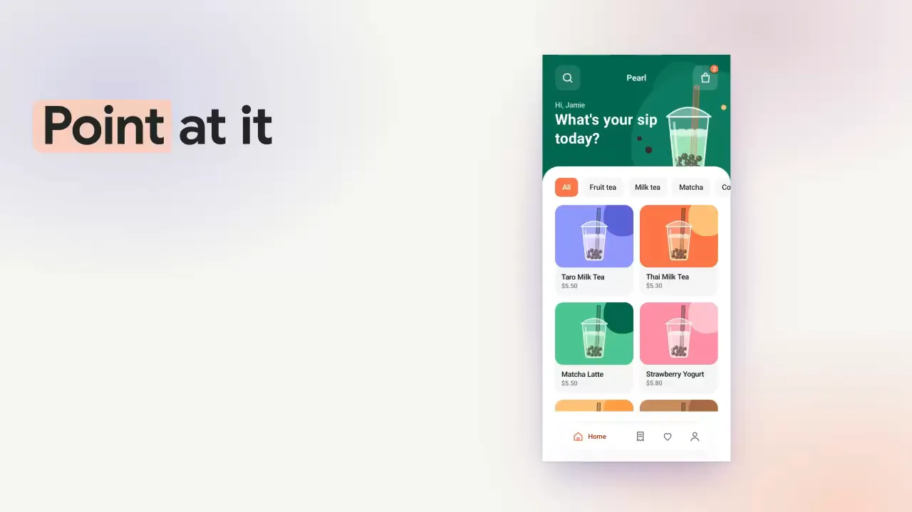
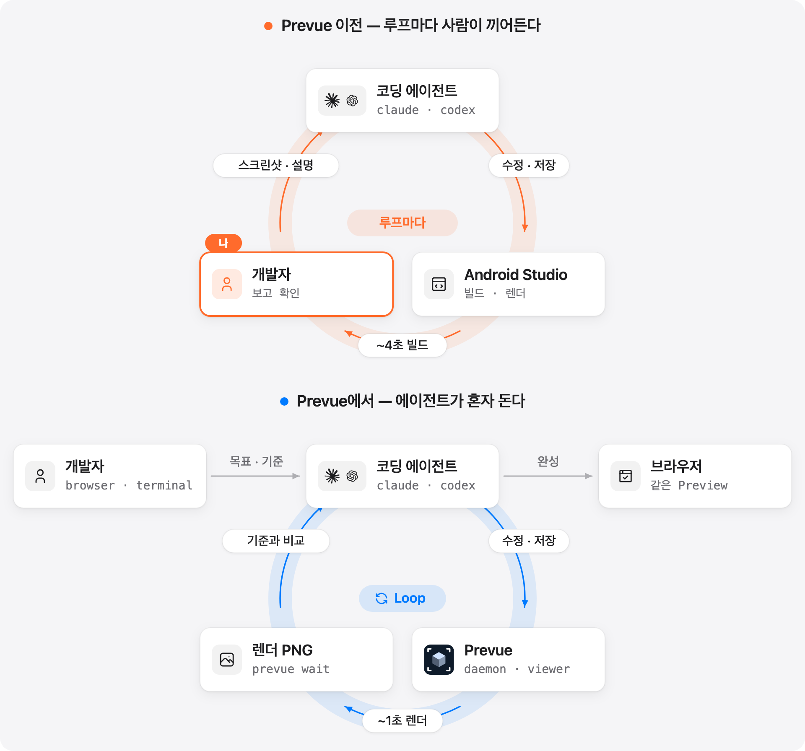
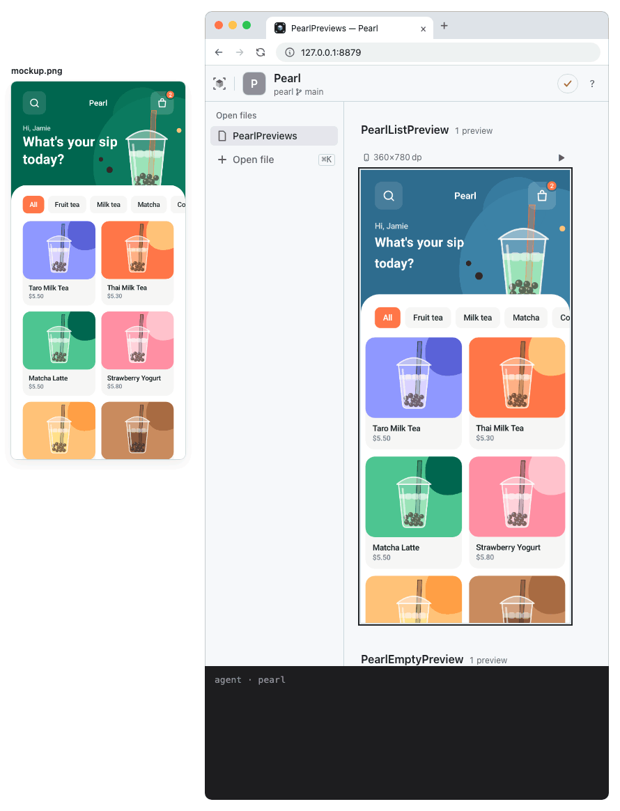
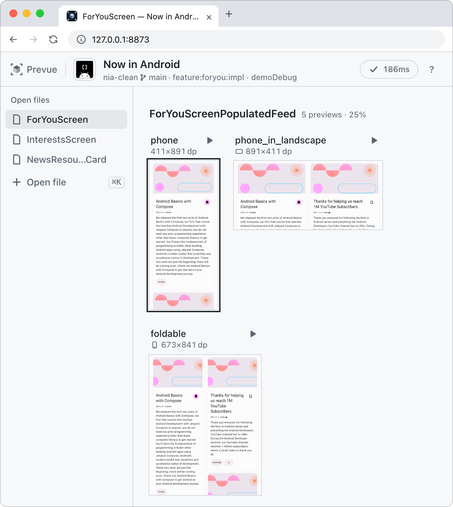
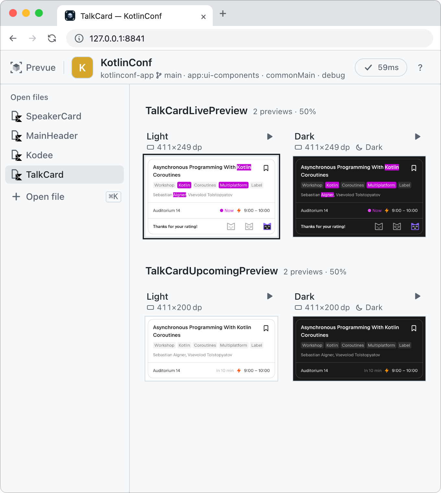
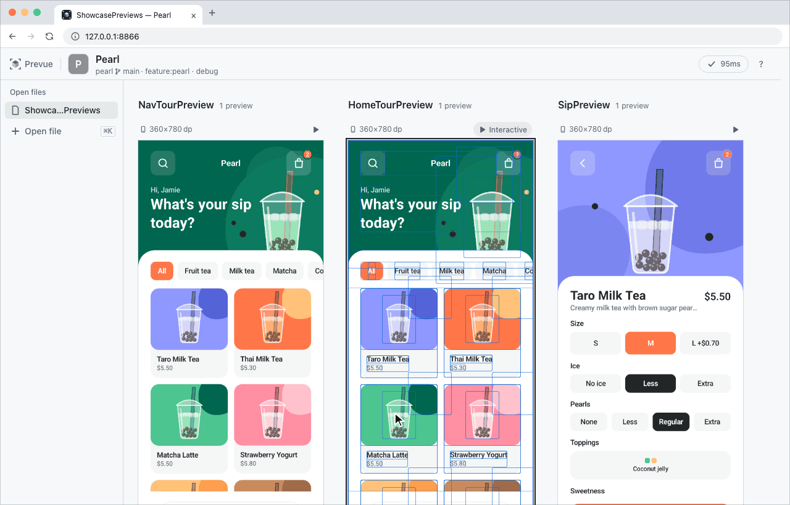
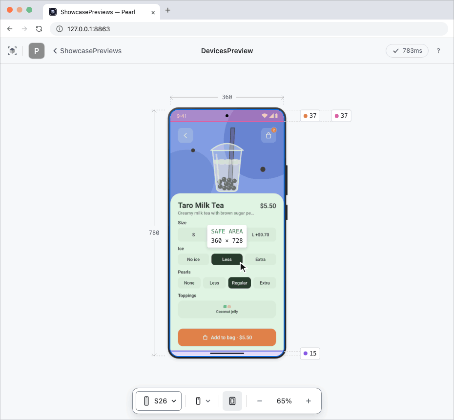
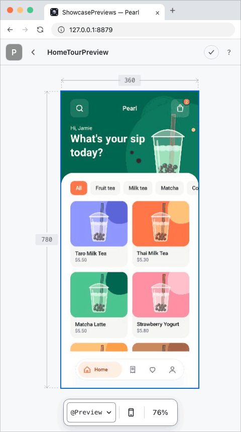
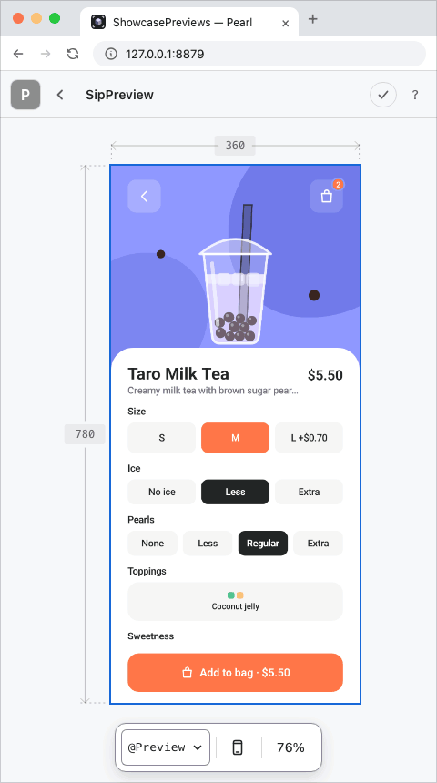
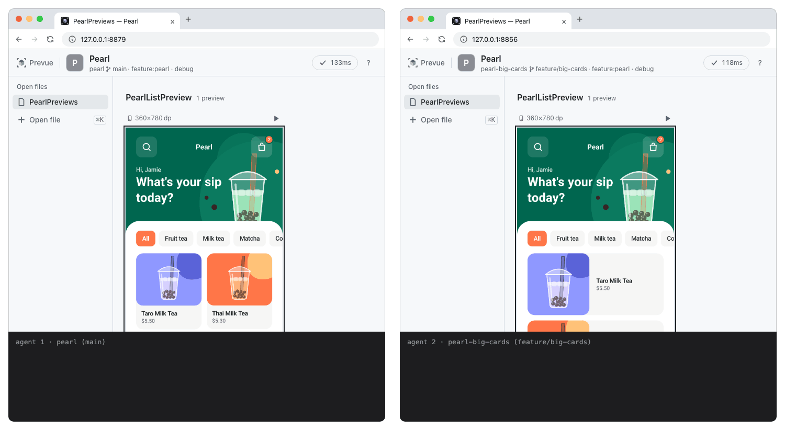

<h1 align="center">
  &nbsp;Prevue
</h1>

<p align="center"><b>Android Studio를 꺼도 Preview는 뜹니다.</b></p>

<p align="center">저장하고 1초면 브라우저의 Compose Preview가 다시 그려집니다.<br>에이전트도 같은 화면을 봅니다.</p>

<p align="center"><a href="README.md">English</a> | <b>한국어</b></p>

<div align="center">

[](https://github.com/kakao/prevue/actions/workflows/build.yml)
[](CHANGELOG.md)
[](LICENSE)
[](#시작하기)
[![Codex](https://img.shields.io/badge/Codex%20plugin-000000?logo=data%3Aimage%2Fsvg%2Bxml%3Bbase64%2CPHN2ZyB4bWxucz0iaHR0cDovL3d3dy53My5vcmcvMjAwMC9zdmciIHZpZXdCb3g9IjAgMCAyNCAyNCI%2BPHBhdGggZmlsbD0iI2ZmZiIgZD0iTTIyLjI4MTkgOS44MjExYTUuOTg0NyA1Ljk4NDcgMCAwIDAtLjUxNTctNC45MTA4IDYuMDQ2MiA2LjA0NjIgMCAwIDAtNi41MDk4LTIuOUE2LjA2NTEgNi4wNjUxIDAgMCAwIDQuOTgwNyA0LjE4MThhNS45ODQ3IDUuOTg0NyAwIDAgMC0zLjk5NzcgMi45IDYuMDQ2MiA2LjA0NjIgMCAwIDAgLjc0MjcgNy4wOTY2IDUuOTggNS45OCAwIDAgMCAuNTExIDQuOTEwNyA2LjA1MSA2LjA1MSAwIDAgMCA2LjUxNDYgMi45MDAxQTUuOTg0NyA1Ljk4NDcgMCAwIDAgMTMuMjU5OSAyNGE2LjA1NTcgNi4wNTU3IDAgMCAwIDUuNzcxOC00LjIwNTggNS45ODk0IDUuOTg5NCAwIDAgMCAzLjk5NzctMi45MDAxIDYuMDU1NyA2LjA1NTcgMCAwIDAtLjc0NzUtNy4wNzI5em0tOS4wMjIgMTIuNjA4MWE0LjQ3NTUgNC40NzU1IDAgMCAxLTIuODc2NC0xLjA0MDhsLjE0MTktLjA4MDQgNC43NzgzLTIuNzU4MmEuNzk0OC43OTQ4IDAgMCAwIC4zOTI3LS42ODEzdi02LjczNjlsMi4wMiAxLjE2ODZhLjA3MS4wNzEgMCAwIDEgLjAzOC4wNTJ2NS41ODI2YTQuNTA0IDQuNTA0IDAgMCAxLTQuNDk0NSA0LjQ5NDR6bS05LjY2MDctNC4xMjU0YTQuNDcwOCA0LjQ3MDggMCAwIDEtLjUzNDYtMy4wMTM3bC4xNDIuMDg1MiA0Ljc4MyAyLjc1ODJhLjc3MTIuNzcxMiAwIDAgMCAuNzgwNiAwbDUuODQyOC0zLjM2ODV2Mi4zMzI0YS4wODA0LjA4MDQgMCAwIDEtLjAzMzIuMDYxNUw5Ljc0IDE5Ljk1MDJhNC40OTkyIDQuNDk5MiAwIDAgMS02LjE0MDgtMS42NDY0ek0yLjM0MDggNy44OTU2YTQuNDg1IDQuNDg1IDAgMCAxIDIuMzY1NS0xLjk3MjhWMTEuNmEuNzY2NC43NjY0IDAgMCAwIC4zODc5LjY3NjVsNS44MTQ0IDMuMzU0My0yLjAyMDEgMS4xNjg1YS4wNzU3LjA3NTcgMCAwIDEtLjA3MSAwbC00LjgzMDMtMi43ODY1QTQuNTA0IDQuNTA0IDAgMCAxIDIuMzQwOCA3Ljg3MnptMTYuNTk2MyAzLjg1NThMMTMuMTAzOCA4LjM2NCAxNS4xMTkyIDcuMmEuMDc1Ny4wNzU3IDAgMCAxIC4wNzEgMGw0LjgzMDMgMi43OTEzYTQuNDk0NCA0LjQ5NDQgMCAwIDEtLjY3NjUgOC4xMDQydi01LjY3NzJhLjc5Ljc5IDAgMCAwLS40MDctLjY2N3ptMi4wMTA3LTMuMDIzMWwtLjE0Mi0uMDg1Mi00Ljc3MzUtMi43ODE4YS43NzU5Ljc3NTkgMCAwIDAtLjc4NTQgMEw5LjQwOSA5LjIyOTdWNi44OTc0YS4wNjYyLjA2NjIgMCAwIDEgLjAyODQtLjA2MTVsNC44MzAzLTIuNzg2NmE0LjQ5OTIgNC40OTkyIDAgMCAxIDYuNjgwMiA0LjY2ek04LjMwNjUgMTIuODYzbC0yLjAyLTEuMTYzOGEuMDgwNC4wODA0IDAgMCAxLS4wMzgtLjA1NjdWNi4wNzQyYTQuNDk5MiA0LjQ5OTIgMCAwIDEgNy4zNzU3LTMuNDUzN2wtLjE0Mi4wODA1TDguNzA0IDUuNDU5YS43OTQ4Ljc5NDggMCAwIDAtLjM5MjcuNjgxM3ptMS4wOTc2LTIuMzY1NGwyLjYwMi0xLjQ5OTggMi42MDY5IDEuNDk5OHYyLjk5OTRsLTIuNTk3NCAxLjQ5OTctMi42MDY3LTEuNDk5N1oiLz48L3N2Zz4%3D)](#시작하기)


</div>

<p align="center"><a href="#시작하기"><b>시작하기 →</b></a></p>

<p align="center">
  
</p>
<p align="center"><sub>가리키기, 핫스왑, 인터랙티브, 모든 화면 — 이 저장소의 예제 앱 Pearl(<a href="fixtures/pearl"><code>fixtures/pearl</code></a>)을 실제로 그린 화면입니다.</sub></p>

에이전트가 화면을 다 고쳤다고 하면, 사람이 Android Studio를 열고 빌드를 기다려 확인합니다.
틀린 곳은 스크린샷을 찍어 설명하고 다시 기다립니다. **코드는 에이전트가 쓰는데 화면은 루프마다 사람이 대신 봐 줍니다.**
Prevue는 저장할 때마다 Preview를 1초 안팎에 다시 그려 에이전트가 직접 보게 하고, 사람은 루프 밖에서 끝난 화면만 확인합니다.

<p align="center">
  
</p>

## 확인도 에이전트가 합니다

시안(Figma 프레임 · 스크린샷 · 목업)을 주면 에이전트가 고치고, 다시 그려진 Preview를 보고, 시안과 비교해 다시 고치기를 혼자 되풀이합니다. 사람은 끝난 화면을 브라우저에서 확인하면 됩니다.

```
이 스크린샷처럼 ForYouScreen 헤더 맞춰줘
```

<p align="center">
  
</p>

탭하거나 드래그해야 바뀌는 화면도 같습니다. 에이전트가 Preview를 인터랙티브 모드로 켜고 터치를 보낸 뒤 바뀐 화면을 받아 봅니다.

## 핫스왑

저장하면 Gradle 없이 1초쯤 뒤 Preview가 새로 뜹니다. 여백 · 색 · 문구 같은 값만 바꿨으면 0.2초쯤입니다([벤치마크](#벤치마크)).
파일 하나의 `@Preview`가 함수별로 묶여 보드에 펼쳐지고 저장할 때마다 모두 다시 그립니다. 에이전트와 사람이 같은 보드를 보니, 에이전트가 "다 됐어요" 하는 순간 사람도 이미 보고 있습니다.

<p align="center">
  
</p>
<p align="center"><sub>왼쪽: <a href="https://github.com/android/nowinandroid">Now in Android</a>(Apache-2.0) · 오른쪽: <a href="https://github.com/JetBrains/kotlinconf-app">KotlinConf 앱</a>, Compose Multiplatform(Apache-2.0)</sub></p>

Kotlin Multiplatform · Compose Multiplatform 모듈도 똑같습니다. commonMain Preview를 Android Studio처럼 그 모듈의 Android 쪽 컴파일로 그리므로, iOS나 웹 타깃이 함께 있어도 괜찮습니다. Compose Multiplatform 리소스(`Res`)도 앱에서처럼 그려집니다.

화면 파일과 컴포넌트 파일을 오가며 고쳐도 연 파일은 왼쪽 목록에 남고, `/` · `⌘K`로 파일 이름 · 머리글자(`fys` → `ForYouScreen.kt`) · Preview 함수 이름을 찾아 엽니다. 전체 단축키는 뷰어에서 `?`로 봅니다.

## 설명 대신 가리키세요

Preview에서 아무 곳이나 클릭하고 에이전트에게 말하면 됩니다. 스크린샷도, "위에서 두 번째 카드"도 필요 없습니다.

```
이거 여백 좀 줄여줘
```

에이전트는 "이거"가 어느 파일의 몇 번째 줄인지 알아냅니다. 클립보드에도 `@경로#L줄`이 복사되어 터미널에 바로 붙여 넣을 수 있습니다.

그림 옆에는 가리킨 것의 카드가 섭니다. 이름 · 파일:줄 · 크기 · Modifier와 함께 둘레의 요소를 작은 트리로 보여 줍니다. 줄을 눌러 부모나 형제를 다시 가리키고, 그 컴포저블을 부르는 Preview로 건너갈 수 있습니다.

<p align="center">
  
</p>

## 인터랙티브 모드

카드의 `▶`를 누르면 크게 열립니다. Android Studio의 Interactive Mode처럼 클릭 · 드래그로 모션과 애니메이션을 확인합니다.
소스를 고치지 않고 화면 크기나 기기(Android 여섯 · iPhone 넷)를 바꾸고, 세로 · 가로 왼쪽 · 가로 오른쪽으로 돌리고, 폴더블은 접었다 폅니다.

- **실제 기기의 인셋이 컴포저블에 들어갑니다** — 값은 [windowinsets.info](https://windowinsets.info/) · [safearea.info](https://safearea.info/)에서 가져왔습니다.
- **인셋 영역 보기**를 켜면 인셋 띠와 안전 영역이 그림 위에 칠해집니다.
- **기기마다 자기 시스템 UI를 그립니다** — Android · iOS · iPhone Duo의 상태 표시줄을 브라우저에서만 그립니다.

<p align="center">
  
</p>

## 에이전트가 셋이어도 가볍게

Preview 한 장을 보려고 Android Studio를 띄우면 Gradle 데몬 · Kotlin 데몬이 함께 떠 메모리를 8GB쯤 씁니다. 저희도 메모리 36GB Mac에서 에이전트 셋에게 워크트리를 하나씩 주자 Android Studio 셋 때문에 스왑이 일어나 모든 작업이 느려졌습니다.

Prevue는 워크트리마다 가벼운 데몬이 따로 뜨고 하나가 Android Studio보다 메모리를 83% 적게 씁니다([벤치마크](#벤치마크)). 두 에이전트가 동시에 저장해도 창마다 따로 다시 그리고 한쪽만 다시 저장하면 다른 쪽은 그대로입니다.

<p align="center">
  
</p>

## 시작하기

### 요구 사항

- **macOS**와 Command Line Tools(`python3`) — 없으면 에이전트가 설치 창을 열어 줍니다.
- **Java** — Android Studio Ladybug(2024.2) 이상이 있으면 따로 준비할 것이 없습니다. 프로젝트가 JDK 17이어도 괜찮습니다.
  - 그보다 오래된 Android Studio는 Java 17을 들고 와서 프리뷰 서버를 띄울 수 없습니다.
  - Android Studio가 없으면 JDK 21 이상을 설치하세요. `brew install openjdk@25`는 sudo 없이 설치되고 Prevue가 그 자리(또는 `Library/Java/JavaVirtualMachines` · SDKMAN)에서 스스로 찾습니다. 25 이상이면 콜드 시작이 1초쯤 빠릅니다.
  - 다른 JDK를 쓰고 싶을 때만 `PREVUE_JDK`에 경로를 넣어 주세요.
- **Android SDK** — 플랫폼을 하나 이상 받아 두고, `~/Library/Android/sdk`가 아니면 `ANDROID_HOME`에 그 경로를 넣어 주세요.

### 설치

```sh
# Claude Code
claude plugin marketplace add https://github.com/kakao/prevue.git
claude plugin install prevue@prevue

# Codex
codex plugin marketplace add https://github.com/kakao/prevue.git
codex plugin add prevue@prevue
```

그다음 에이전트에게 파일 이름을 말하면 됩니다. 스킬을 직접 부르면 더 확실합니다. Claude Code는 `/prevue`, Codex는 `$prevue:prevue`입니다.

```
ForYouScreen.kt Preview 실행해줘
```

Kotlin Multiplatform · Compose Multiplatform 프로젝트도 똑같이 commonMain의 파일 이름을 말하면 됩니다.

따로 설정할 것은 없습니다. 처음 실행할 때 필요한 준비는 에이전트가 확인을 받아 가며 진행합니다. 준비가 끝나면 브라우저가 열리고 그 파일의 `@Preview`가 모두 뜹니다.
프로젝트의 빌드 파일 · 플러그인 · 태스크를 바꾸지 않고, 프로젝트 안에 파일도 만들지 않습니다. Gradle은 모듈마다 처음 한 번만 실행되고 그 뒤로는 공용 모듈을 고쳐도 바로 다시 그립니다.

### 업데이트

마켓플레이스 정보를 먼저 갱신한 뒤 플러그인을 업데이트합니다. 이 단계를 건너뛰면 옛 버전 정보를 보고 "이미 최신"이라고 답합니다.

```sh
# Claude Code — 재시작하거나 /reload-plugins 뒤에 적용된다
claude plugin marketplace update prevue
claude plugin update prevue@prevue

# Codex — update 가 없어 add 를 다시 부른다
codex plugin marketplace upgrade
codex plugin add prevue@prevue
```

바뀐 것은 [CHANGELOG.md](CHANGELOG.md)에 있습니다.
막히면 에이전트에게 `prevue log`를 읽어 달라고 하세요. 그래도 안 되면 [이슈로 알려 주세요](https://github.com/kakao/prevue/issues/new?template=not-working.yml).

## 지원 범위

| 되는 것 | 안 되는 것 |
|---|---|
| Android 모듈(app · library) | 순수 JVM 모듈 |
| Android 타깃이 있는 Kotlin Multiplatform · Compose Multiplatform 모듈 — AGP 9의 `com.android.kotlin.multiplatform.library`, 또는 `kotlin.multiplatform` + `com.android.library` | Android 타깃이 없는 KMP 모듈, Amper처럼 Gradle이 아닌 빌드 |
| commonMain 파일도 저장하면 Gradle 없이 다시 그립니다 | `expect` · `actual` 선언이 든 파일 — 저장해도 Gradle 빌드 전까지 이전 그림이 남습니다 |
| debug 계열 변형. Android Studio의 Build Variants 기본 규칙으로 고르고, 다른 것은 에이전트에게 말하면 됩니다 | release 변형 |
| 최상위 `@Preview` 함수. Multipreview와 `@PreviewParameter`도 펼쳐서 그립니다 | 클래스 안에 선언한 멤버 Preview |
| 실기기가 없어도 그려지는 컴포저블 | DI 컨테이너나 `AndroidView`가 필요한 Preview — 실패 종류가 `DI` · `ANDROID_VIEW`로 표시됩니다 |

## 벤치마크

위는 같은 일을 Android Studio와 Prevue로 한 결과, 아래는 바꾼 종류마다 새 그림이 뜨기까지의 시간입니다.

<p align="center">
  
</p>

<p align="center">
  
</p>

- **측정 사양** — Apple Silicon 14코어 · RAM 36GB · nowinandroid `ForYouScreen.kt`(Preview 25장). Android Studio 2026.1.3은 2026-09-22에, Prevue(develop `feb5c6e`)는 2026-10-23에 쟀습니다. Prevue 값은 중앙값입니다
- **Hot Swap** — 저장한 뒤 25장이 전부 새 그림이 되기까지. 첫 장은 0.9초에 나옵니다
- **First Preview** — Android Studio는 프로젝트를 열고, Prevue는 데몬을 띄우고 첫 렌더가 끝나기까지
- **Memory** — Android Studio는 한 시점의 IDE와 Gradle 데몬 합계, Prevue는 저장 10번 뒤 데몬 하나의 메모리 사용량입니다. 모듈을 오가며 오래 써도 1.6GB가 최대였고, 10분 동안 쓰지 않으면 스스로 종료됩니다
- **Disk** — Android Studio 앱 번들 대 `~/.prevue/toolchain`. JDK 25 이상이면 데몬을 빨리 띄우려고 `~/.prevue/aot`에 200MB 안팎의 클래스 캐시를 더 둡니다
- **Prevue가 다시 그리는 속도** — 리터럴 · 리소스 값 저장은 컴파일을 건너뜁니다. 모듈 전환과 기기 바꾸기는 새 그림이 나오기까지, 인터랙티브는 피드를 드래그하는 동안 뷰어 스트림의 프레임 수입니다

## 명령

에이전트가 쓰는 명령이라 직접 입력할 일은 드뭅니다. 실행 파일은 플러그인이 설치된 디렉터리의 `bin/prevue`이고
전체 명령과 종료 코드는 `prevue --help`, 명령마다 `prevue <명령> --help`로 봅니다. 직접 쓸 만한 명령은 넷입니다.

| 명령 | 하는 일 |
|---|---|
| `prevue open` | 닫은 뷰어를 브라우저에 다시 엽니다 |
| `prevue stop` | 그 저장소에서 띄운 데몬을 내립니다(`--all`은 떠 있는 것 전부) |
| `prevue log` | 데몬 로그 — 막혔을 때 에이전트에게 읽어 달라고 합니다 |
| `prevue paths` | 툴체인 · 덤프 · 산출물이 어디에 얼마나 있는지 — 지울 곳을 찾을 때 |

## License

This software is licensed under the Apache 2 license, quoted below.

Copyright 2026 Kakao Corp. http://www.kakaocorp.com

Licensed under the Apache License, Version 2.0 (the "License"); you may not use this project except in compliance with the License. You may obtain a copy of the License at http://www.apache.org/licenses/LICENSE-2.0.

Unless required by applicable law or agreed to in writing, software distributed under the License is distributed on an "AS IS" BASIS, WITHOUT WARRANTIES OR CONDITIONS OF ANY KIND, either express or implied. See the License for the specific language governing permissions and limitations under the License.
