<h1 align="center">
  &nbsp;Prevue
</h1>

<p align="center"><b>Android Studio를 꺼도 Preview는 뜹니다.</b></p>

<p align="center">저장하고 1초면 브라우저의 Compose Preview가 다시 그려집니다.<br>에이전트도 같은 화면을 봅니다.</p>

<p align="center"><a href="README.md">English</a> | <b>한국어</b></p>

<div align="center">

[](https://github.com/kakao/prevue/actions/workflows/build.yml)
[](CHANGELOG.md)
[](LICENSE)
[](#시작하기)
[![Codex](https://img.shields.io/badge/Codex%20plugin-000000?logo=data%3Aimage%2Fsvg%2Bxml%3Bbase64%2CPHN2ZyB4bWxucz0iaHR0cDovL3d3dy53My5vcmcvMjAwMC9zdmciIHZpZXdCb3g9IjAgMCAyNCAyNCI%2BPHBhdGggZmlsbD0iI2ZmZiIgZD0iTTIyLjI4MTkgOS44MjExYTUuOTg0NyA1Ljk4NDcgMCAwIDAtLjUxNTctNC45MTA4IDYuMDQ2MiA2LjA0NjIgMCAwIDAtNi41MDk4LTIuOUE2LjA2NTEgNi4wNjUxIDAgMCAwIDQuOTgwNyA0LjE4MThhNS45ODQ3IDUuOTg0NyAwIDAgMC0zLjk5NzcgMi45IDYuMDQ2MiA2LjA0NjIgMCAwIDAgLjc0MjcgNy4wOTY2IDUuOTggNS45OCAwIDAgMCAuNTExIDQuOTEwNyA2LjA1MSA2LjA1MSAwIDAgMCA2LjUxNDYgMi45MDAxQTUuOTg0NyA1Ljk4NDcgMCAwIDAgMTMuMjU5OSAyNGE2LjA1NTcgNi4wNTU3IDAgMCAwIDUuNzcxOC00LjIwNTggNS45ODk0IDUuOTg5NCAwIDAgMCAzLjk5NzctMi45MDAxIDYuMDU1NyA2LjA1NTcgMCAwIDAtLjc0NzUtNy4wNzI5em0tOS4wMjIgMTIuNjA4MWE0LjQ3NTUgNC40NzU1IDAgMCAxLTIuODc2NC0xLjA0MDhsLjE0MTktLjA4MDQgNC43NzgzLTIuNzU4MmEuNzk0OC43OTQ4IDAgMCAwIC4zOTI3LS42ODEzdi02LjczNjlsMi4wMiAxLjE2ODZhLjA3MS4wNzEgMCAwIDEgLjAzOC4wNTJ2NS41ODI2YTQuNTA0IDQuNTA0IDAgMCAxLTQuNDk0NSA0LjQ5NDR6bS05LjY2MDctNC4xMjU0YTQuNDcwOCA0LjQ3MDggMCAwIDEtLjUzNDYtMy4wMTM3bC4xNDIuMDg1MiA0Ljc4MyAyLjc1ODJhLjc3MTIuNzcxMiAwIDAgMCAuNzgwNiAwbDUuODQyOC0zLjM2ODV2Mi4zMzI0YS4wODA0LjA4MDQgMCAwIDEtLjAzMzIuMDYxNUw5Ljc0IDE5Ljk1MDJhNC40OTkyIDQuNDk5MiAwIDAgMS02LjE0MDgtMS42NDY0ek0yLjM0MDggNy44OTU2YTQuNDg1IDQuNDg1IDAgMCAxIDIuMzY1NS0xLjk3MjhWMTEuNmEuNzY2NC43NjY0IDAgMCAwIC4zODc5LjY3NjVsNS44MTQ0IDMuMzU0My0yLjAyMDEgMS4xNjg1YS4wNzU3LjA3NTcgMCAwIDEtLjA3MSAwbC00LjgzMDMtMi43ODY1QTQuNTA0IDQuNTA0IDAgMCAxIDIuMzQwOCA3Ljg3MnptMTYuNTk2MyAzLjg1NThMMTMuMTAzOCA4LjM2NCAxNS4xMTkyIDcuMmEuMDc1Ny4wNzU3IDAgMCAxIC4wNzEgMGw0LjgzMDMgMi43OTEzYTQuNDk0NCA0LjQ5NDQgMCAwIDEtLjY3NjUgOC4xMDQydi01LjY3NzJhLjc5Ljc5IDAgMCAwLS40MDctLjY2N3ptMi4wMTA3LTMuMDIzMWwtLjE0Mi0uMDg1Mi00Ljc3MzUtMi43ODE4YS43NzU5Ljc3NTkgMCAwIDAtLjc4NTQgMEw5LjQwOSA5LjIyOTdWNi44OTc0YS4wNjYyLjA2NjIgMCAwIDEgLjAyODQtLjA2MTVsNC44MzAzLTIuNzg2NmE0LjQ5OTIgNC40OTkyIDAgMCAxIDYuNjgwMiA0LjY2ek04LjMwNjUgMTIuODYzbC0yLjAyLTEuMTYzOGEuMDgwNC4wODA0IDAgMCAxLS4wMzgtLjA1NjdWNi4wNzQyYTQuNDk5MiA0LjQ5OTIgMCAwIDEgNy4zNzU3LTMuNDUzN2wtLjE0Mi4wODA1TDguNzA0IDUuNDU5YS43OTQ4Ljc5NDggMCAwIDAtLjM5MjcuNjgxM3ptMS4wOTc2LTIuMzY1NGwyLjYwMi0xLjQ5OTggMi42MDY5IDEuNDk5OHYyLjk5OTRsLTIuNTk3NCAxLjQ5OTctMi42MDY3LTEuNDk5N1oiLz48L3N2Zz4%3D)](#시작하기)


</div>

<p align="center"><a href="#시작하기"><b>시작하기 →</b></a></p>

<p align="center">
  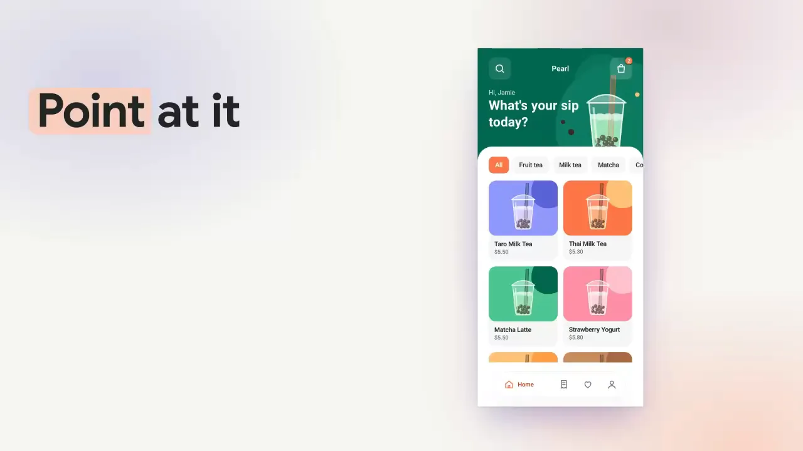
</p>
<p align="center"><sub>가리키기, 핫스왑, 인터랙티브, 모든 화면 — 모두 이 저장소의 예제 앱 Pearl(<a href="fixtures/pearl"><code>fixtures/pearl</code></a>)을 실제로 그린 화면입니다.</sub></p>

에이전트는 Compose 화면을 고칠 수는 있어도 볼 수는 없습니다. 그래서 고칠 때마다 사람이 Android Studio 빌드를 기다려 확인하고, 틀린 곳을 스크린샷으로 설명해 줘야 합니다.
Prevue는 저장할 때마다 1초 안팎으로 Preview를 다시 그려 에이전트에게 보여 줍니다. 에이전트가 혼자 고치고 확인하니, 사람은 다 된 화면만 보면 됩니다.

<p align="center">
  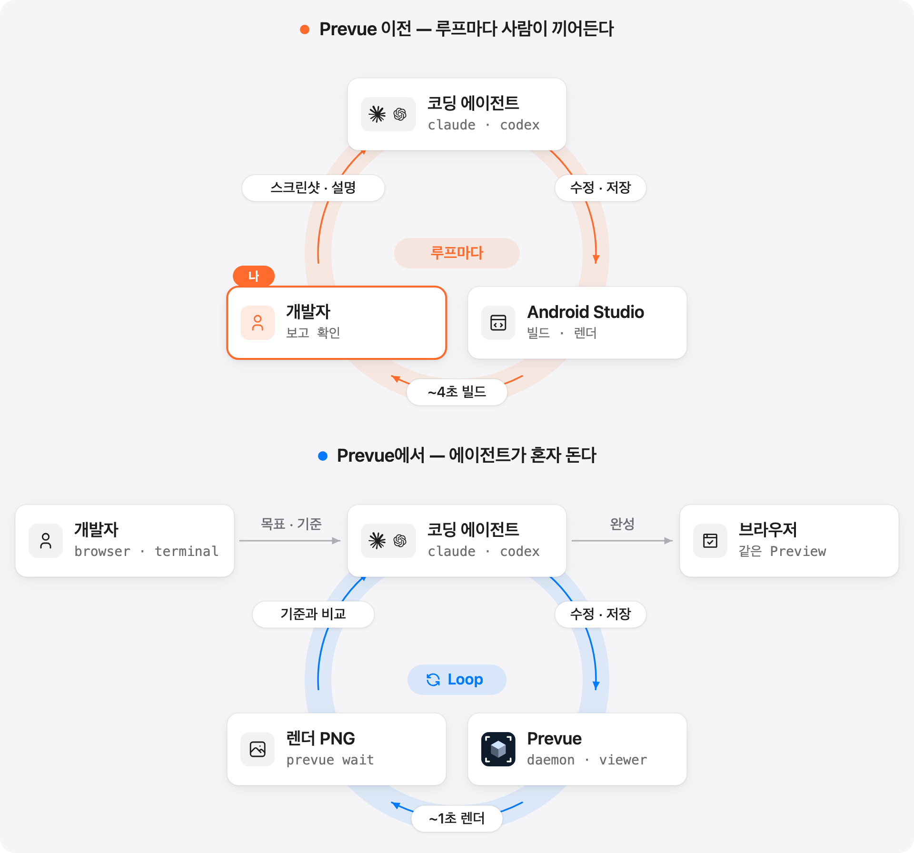
</p>

## 확인도 에이전트가 합니다

시안(Figma 프레임 · 스크린샷 · 목업)만 주면 됩니다. 에이전트가 고치고, 다시 그려진 Preview를 시안과 비교하고, 맞을 때까지 이 과정을 되풀이합니다. 사람은 다 된 화면을 브라우저에서 확인만 하세요.

```
이 스크린샷처럼 ForYouScreen 헤더 맞춰줘
```

<p align="center">
  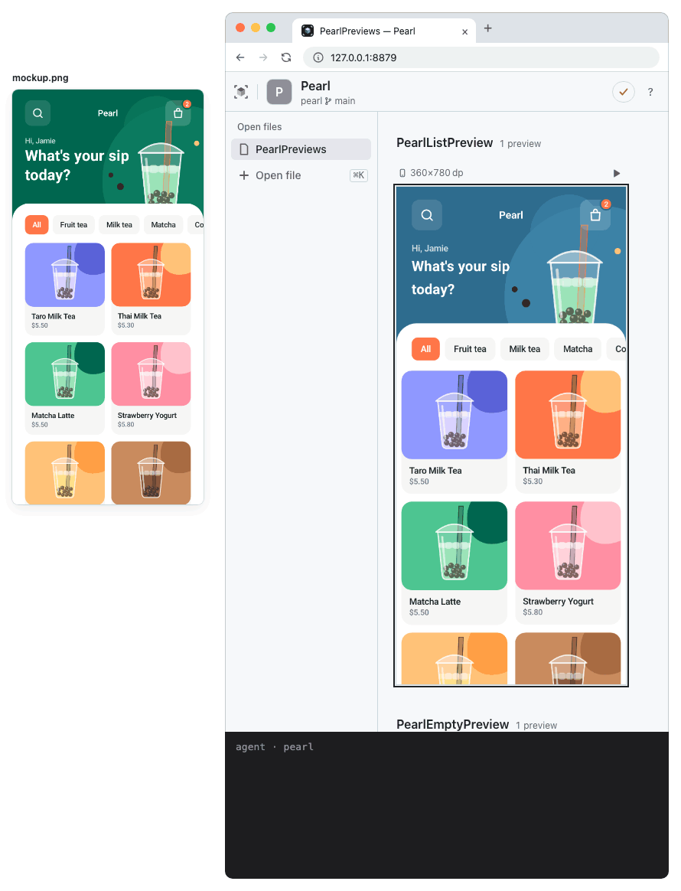
</p>

탭이나 드래그로 바뀌는 화면도 확인합니다. 에이전트가 Preview에 직접 터치를 보내고 바뀐 화면을 받아 봅니다.

## 핫스왑

저장하면 Gradle 없이 1초쯤 뒤에 Preview가 새로 뜹니다. 여백 · 색 · 문구 같은 값만 바꿨다면 0.2초쯤 걸립니다([벤치마크](#벤치마크)).
한 파일의 `@Preview`는 함수별로 묶여 보드 한 장에 펼쳐지고, 저장할 때마다 전부 다시 그려집니다. 에이전트와 사람이 같은 보드를 보니, 에이전트가 "다 됐어요"라고 할 때면 사람도 이미 결과를 보고 있습니다.

<p align="center">
  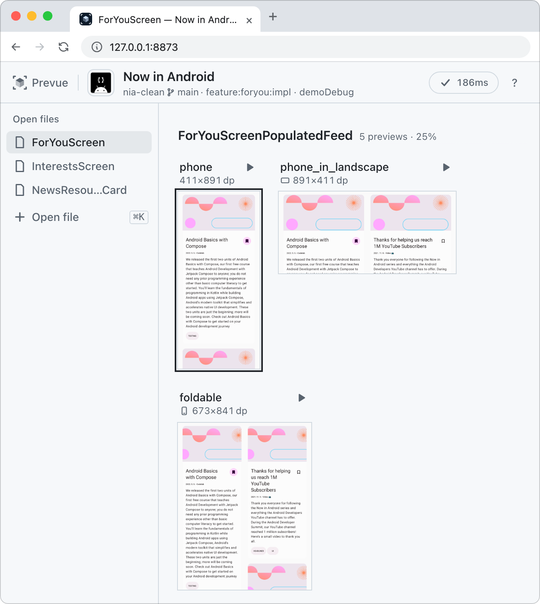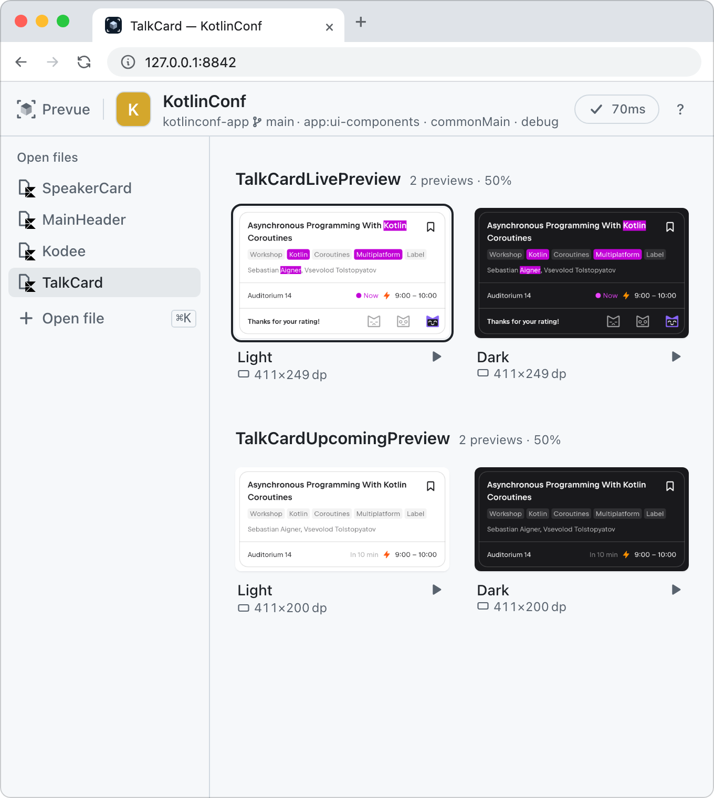
</p>
<p align="center"><sub>왼쪽: <a href="https://github.com/android/nowinandroid">Now in Android</a>(Apache-2.0) · 오른쪽: <a href="https://github.com/JetBrains/kotlinconf-app">KotlinConf 앱</a>, Compose Multiplatform(Apache-2.0)</sub></p>

Kotlin Multiplatform · Compose Multiplatform 모듈도 그대로 됩니다. commonMain Preview도 Android Studio처럼 그 모듈의 Android 쪽으로 컴파일해 그리므로, iOS나 웹 타깃이 같이 있어도 괜찮습니다. Compose Multiplatform 리소스(`Res`)도 앱과 똑같이 나옵니다.

화면 파일과 컴포넌트 파일을 오가며 고치더라도 한 번 연 파일은 왼쪽 목록에 남아 있습니다. `/`나 `⌘K`를 누르면 파일 이름 · 머리글자(`fys` → `ForYouScreen.kt`) · Preview 함수 이름으로 찾아 열 수 있습니다. 단축키 전체는 뷰어에서 `?`를 누르면 나옵니다.

## 모든 Preview를 한눈에

Preview 파일이 많아지면 이름이 기억나지 않아 찾기 어렵습니다. **모든 Preview** 화면은 프로젝트의 Preview 파일을 전부 카드로 늘어놓아, 이름을 몰라도 눈으로 훑어 고를 수 있게 합니다. 최근에 바뀐 파일이 맨 앞에 옵니다.
카드에는 그 파일의 Preview 그림과 파일 이름 · 패키지 · 모듈이 나옵니다. 카드를 누르면 앞의 몇 장을 펼쳐 보고, 그 파일의 보드로 넘어갈 수 있습니다.

<p align="center">
  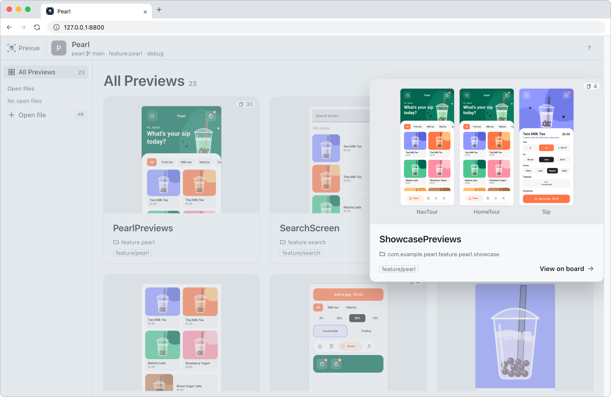
</p>

## 설명 대신 가리키세요

고칠 곳을 말로 설명하기는 번거롭습니다. Preview에서 그 자리를 클릭하고 에이전트에게 할 일만 말하세요. 스크린샷도, "위에서 두 번째 카드" 같은 설명도 필요 없습니다.

```
이거 여백 좀 줄여줘
```

에이전트는 "이거"가 어느 파일 몇 번째 줄인지 압니다. 클립보드에도 `@경로#L줄`이 복사되니 터미널에 바로 붙여 넣어도 됩니다.

가리키면 그림 옆에 카드가 열립니다. 카드에는 이름 · 파일:줄 · 크기 · Modifier와 함께 주변 요소가 작은 트리로 나옵니다. 트리의 줄을 눌러 부모나 형제 요소를 가리키거나, 그 컴포저블을 호출하는 Preview로 건너갈 수 있습니다.

<p align="center">
  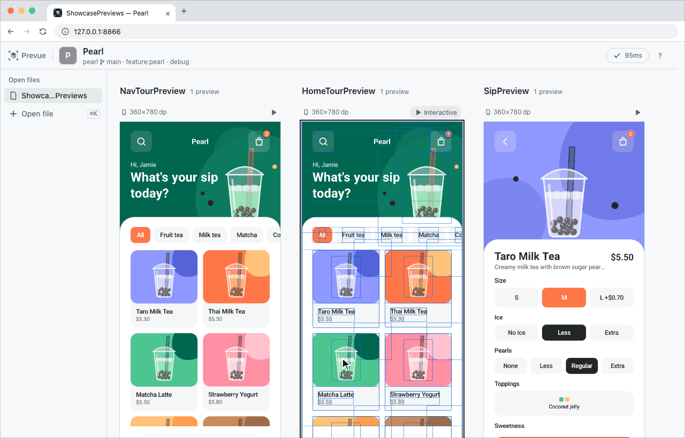
</p>

## 인터랙티브 모드

보드의 카드에서 `▶`를 누르면 Preview가 크게 열립니다. Android Studio의 Interactive Mode처럼 클릭하고 드래그하며 모션과 애니메이션을 확인할 수 있습니다.
소스를 고치지 않고도 화면 크기나 기기(Android 6종 · iPhone 4종)를 바꾸고, 세로 · 가로(왼쪽) · 가로(오른쪽)로 돌리고, 폴더블을 접었다 펼 수 있습니다.

- **실제 기기의 인셋이 컴포저블에 그대로 들어갑니다** — 값은 [windowinsets.info](https://windowinsets.info/) · [safearea.info](https://safearea.info/)에서 가져왔습니다.
- **인셋 영역 보기**를 켜면 인셋 띠와 안전 영역이 그림 위에 색으로 표시됩니다.
- **기기별 시스템 UI까지 그립니다** — Android · iOS · iPhone Duo의 상태 표시줄과 카메라가 브라우저 화면뿐 아니라 에이전트가 읽는 PNG에도 들어갑니다.

<p align="center">
  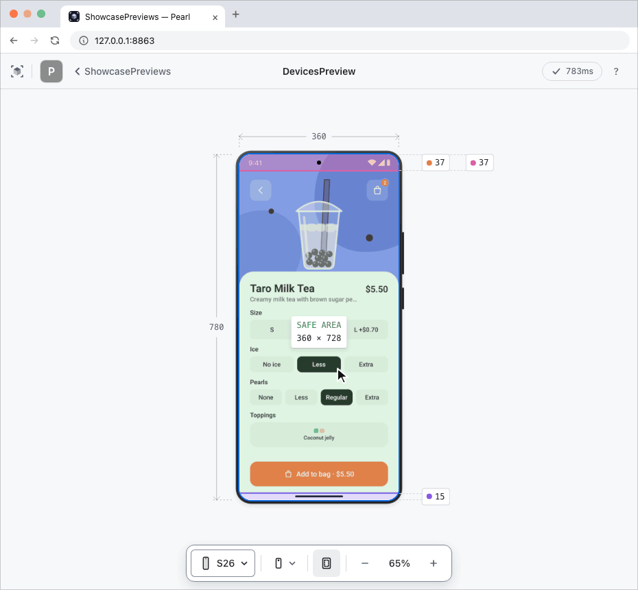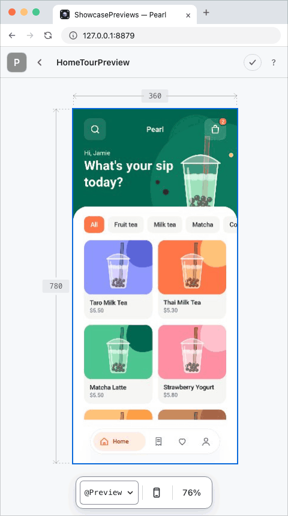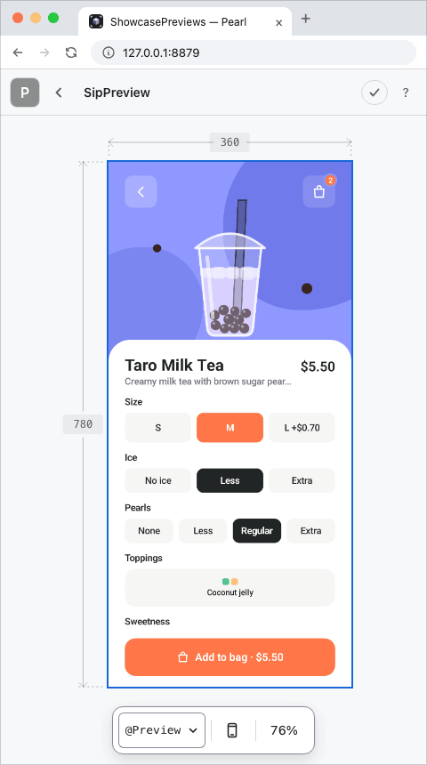
</p>

## 에이전트가 셋이어도 가볍게

Preview 한 장을 보려고 Android Studio를 띄우면 Gradle 데몬과 Kotlin 데몬까지 함께 떠서 메모리를 8GB쯤 씁니다. 저희도 메모리 36GB Mac에서 에이전트 셋에게 워크트리를 하나씩 맡겼더니, Android Studio 세 개가 메모리를 다 차지해 스왑이 일어나고 모든 작업이 느려졌습니다.

Prevue는 워크트리마다 가벼운 데몬을 하나씩 띄우고, 데몬 하나는 Android Studio보다 메모리를 83% 적게 씁니다([벤치마크](#벤치마크)). 두 에이전트가 동시에 저장해도 창마다 따로 다시 그려지고, 한쪽만 다시 저장하면 다른 쪽 창은 그대로입니다.

<p align="center">
  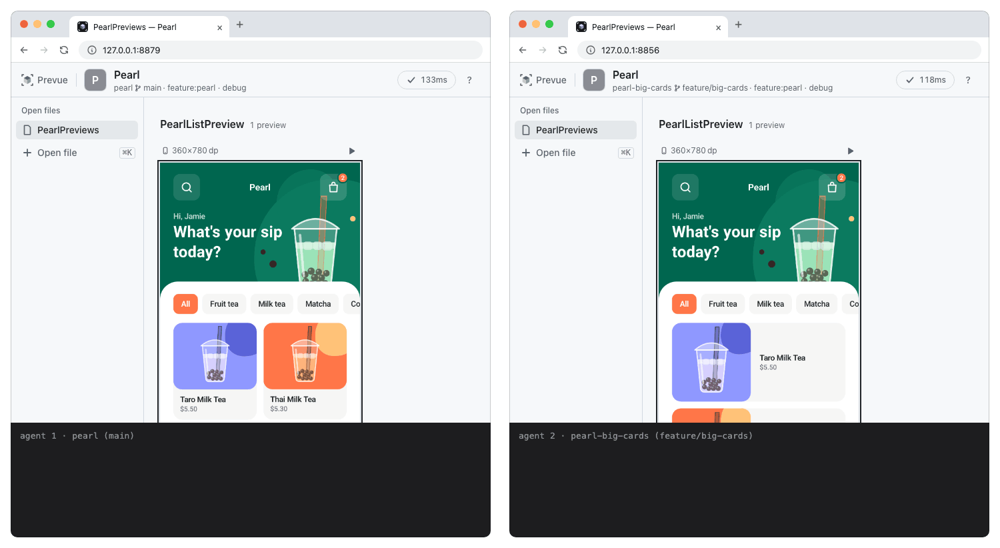
</p>

## 시작하기

### 요구 사항

- **macOS**와 Command Line Tools(`python3`) — 없으면 에이전트가 설치 창을 열어 줍니다.
- **Java** — Android Studio Ladybug(2024.2) 이상이 있으면 따로 준비할 것이 없습니다. 프로젝트가 JDK 17이어도 괜찮습니다.
  - 그보다 오래된 Android Studio에 들어 있는 Java 17로는 프리뷰 서버를 띄울 수 없습니다.
  - Android Studio가 없으면 JDK 21 이상을 설치하세요. `brew install openjdk@25`는 sudo 없이 설치되고, Prevue가 그 위치(또는 `Library/Java/JavaVirtualMachines` · SDKMAN)에서 알아서 찾습니다. JDK 25 이상이면 콜드 스타트가 1초쯤 빨라집니다.
  - 다른 JDK를 쓰고 싶을 때만 `PREVUE_JDK`에 경로를 넣어 주세요.
- **Android SDK** — 플랫폼을 하나 이상 설치해 두세요. SDK가 `~/Library/Android/sdk`에 있지 않으면 `ANDROID_HOME`에 그 경로를 넣어 주세요.

### 설치

```sh
# Claude Code
claude plugin marketplace add https://github.com/kakao/prevue.git
claude plugin install prevue@prevue

# Codex
codex plugin marketplace add https://github.com/kakao/prevue.git
codex plugin add prevue@prevue
```

설치한 뒤에는 에이전트에게 파일 이름만 말하면 됩니다. 스킬을 직접 부르면 더 확실합니다(Claude Code는 `/prevue`, Codex는 `$prevue:prevue`).

```
ForYouScreen.kt Preview 실행해줘
```

Kotlin Multiplatform · Compose Multiplatform 프로젝트라면 commonMain의 파일 이름을 똑같이 말하면 됩니다.

따로 설정할 것은 없습니다. 처음 실행할 때 필요한 준비는 에이전트가 진행하고, 단계마다 확인을 받습니다. 준비가 끝나면 브라우저가 열리고 그 파일의 `@Preview`가 모두 뜹니다.
Prevue는 프로젝트의 빌드 파일 · 플러그인 · 태스크를 바꾸지 않고, 프로젝트 안에 파일도 만들지 않습니다. Gradle은 모듈마다 처음 한 번만 돌고, 그 뒤로는 공용 모듈을 고쳐도 바로 다시 그립니다.

### 업데이트

업데이트할 때는 마켓플레이스 정보부터 갱신하세요. 이 단계를 건너뛰면 예전 정보를 보고 "이미 최신"이라고 나옵니다.

```sh
# Claude Code — 재시작하거나 /reload-plugins를 실행해야 적용됩니다
claude plugin marketplace update prevue
claude plugin update prevue@prevue

# Codex — update 명령이 없어 add를 다시 실행합니다
codex plugin marketplace upgrade
codex plugin add prevue@prevue
```

바뀐 내용은 [CHANGELOG.md](CHANGELOG.md)에서 볼 수 있습니다.
막히면 에이전트에게 `prevue log`를 읽어 달라고 하세요. 그래도 안 되면 [이슈로 알려 주세요](https://github.com/kakao/prevue/issues/new?template=not-working.yml).

## 지원 범위

| 되는 것 | 안 되는 것 |
|---|---|
| Android 모듈(app · library) | 순수 JVM 모듈 |
| Android 타깃이 있는 Kotlin Multiplatform · Compose Multiplatform 모듈 — AGP 9의 `com.android.kotlin.multiplatform.library`, 또는 `kotlin.multiplatform` + `com.android.library` | Android 타깃이 없는 KMP 모듈, Amper처럼 Gradle이 아닌 빌드 |
| commonMain 파일도 저장하면 Gradle 없이 다시 그립니다 | `expect` · `actual` 선언이 든 파일 — 저장해도 Gradle 빌드 전까지 이전 그림이 남습니다 |
| debug 계열 변형. Android Studio의 Build Variants 기본 규칙대로 고르고, 다른 변형이 필요하면 에이전트에게 말하면 됩니다 | release 변형 |
| 최상위 `@Preview` 함수. Multipreview와 `@PreviewParameter`도 펼쳐서 그립니다 | 클래스 안에 선언한 멤버 Preview |
| 실기기가 없어도 그려지는 컴포저블 | DI 컨테이너나 `AndroidView`가 필요한 Preview — 실패 종류가 `DI` · `ANDROID_VIEW`로 표시됩니다 |

## 벤치마크

위 그림은 같은 작업을 Android Studio와 Prevue로 했을 때의 비교이고, 아래 그림은 바꾼 내용의 종류별로 새 그림이 뜨기까지 걸린 시간입니다.

<p align="center">
  
</p>

<p align="center">
  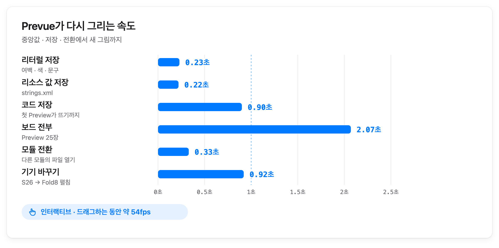
</p>

- **측정 사양** — Apple Silicon 14코어 · RAM 36GB · nowinandroid `ForYouScreen.kt`(Preview 25장). Android Studio 2026.1.3은 2026-09-22에, Prevue(develop `feb5c6e`)는 2026-10-23에 측정했습니다. Prevue 값은 중앙값입니다
- **Hot Swap** — 저장한 뒤 25장이 모두 새로 그려지기까지. 첫 장은 0.9초에 나옵니다
- **First Preview** — Android Studio는 프로젝트를 열고, Prevue는 데몬을 띄우고 첫 렌더가 끝나기까지
- **Memory** — Android Studio는 한 시점에 IDE와 Gradle 데몬이 쓴 메모리의 합계, Prevue는 10번 저장한 뒤 데몬 하나가 쓴 메모리입니다. 모듈을 오가며 오래 써도 최대 1.6GB였고, 1시간 동안 쓰지 않으면 데몬이 스스로 종료됩니다(`prevue start --idle <분>`으로 조절)
- **Disk** — Android Studio 앱 번들 대 `~/.prevue/toolchain`. JDK 25 이상에서는 데몬을 빨리 띄우기 위해 `~/.prevue/aot`에 200MB 안팎의 클래스 캐시를 추가로 둡니다
- **Prevue가 다시 그리는 속도** — 리터럴이나 리소스 값만 바꿔 저장하면 컴파일을 건너뜁니다. 모듈 전환과 기기 바꾸기는 새 그림이 나오기까지의 시간, 인터랙티브는 피드를 드래그하는 동안 뷰어 스트림의 초당 프레임 수입니다

## 명령

에이전트가 쓰는 명령이라 직접 입력할 일은 드뭅니다. 실행 파일은 플러그인이 설치된 디렉터리의 `bin/prevue`입니다.
전체 명령과 종료 코드는 `prevue --help`로, 명령별 설명은 `prevue <명령> --help`로 봅니다. 직접 쓸 만한 명령은 네 가지입니다.

| 명령 | 하는 일 |
|---|---|
| `prevue open` | 닫은 뷰어를 브라우저에 다시 엽니다 |
| `prevue stop` | 그 저장소에서 띄운 데몬을 끕니다(`--all`이면 떠 있는 데몬 전부) |
| `prevue log` | 데몬 로그 — 막혔을 때 에이전트에게 읽어 달라고 합니다 |
| `prevue paths` | 툴체인 · 덤프 · 산출물의 위치와 크기 — 지울 곳을 찾을 때 |

## License

This software is licensed under the Apache 2 license, quoted below.

Copyright 2026 Kakao Corp. http://www.kakaocorp.com

Licensed under the Apache License, Version 2.0 (the "License"); you may not use this project except in compliance with the License. You may obtain a copy of the License at http://www.apache.org/licenses/LICENSE-2.0.

Unless required by applicable law or agreed to in writing, software distributed under the License is distributed on an "AS IS" BASIS, WITHOUT WARRANTIES OR CONDITIONS OF ANY KIND, either express or implied. See the License for the specific language governing permissions and limitations under the License.
