<h1 align="center">
  &nbsp;Prevue
</h1>

<p align="center"><b>Compose Previews, without Android Studio.</b></p>

<p align="center">Save, and it redraws in the browser in a second.<br>Your agent sees the same screen.</p>

<p align="center"><b>English</b> | <a href="README.ko.md">한국어</a></p>

<div align="center">

[](https://github.com/kakao/prevue/actions/workflows/ci.yml)
[](CHANGELOG.md)
[](LICENSE)
[](#get-started)
[![Codex](https://img.shields.io/badge/Codex%20plugin-000000?logo=data%3Aimage%2Fsvg%2Bxml%3Bbase64%2CPHN2ZyB4bWxucz0iaHR0cDovL3d3dy53My5vcmcvMjAwMC9zdmciIHZpZXdCb3g9IjAgMCAyNCAyNCI%2BPHBhdGggZmlsbD0iI2ZmZiIgZD0iTTIyLjI4MTkgOS44MjExYTUuOTg0NyA1Ljk4NDcgMCAwIDAtLjUxNTctNC45MTA4IDYuMDQ2MiA2LjA0NjIgMCAwIDAtNi41MDk4LTIuOUE2LjA2NTEgNi4wNjUxIDAgMCAwIDQuOTgwNyA0LjE4MThhNS45ODQ3IDUuOTg0NyAwIDAgMC0zLjk5NzcgMi45IDYuMDQ2MiA2LjA0NjIgMCAwIDAgLjc0MjcgNy4wOTY2IDUuOTggNS45OCAwIDAgMCAuNTExIDQuOTEwNyA2LjA1MSA2LjA1MSAwIDAgMCA2LjUxNDYgMi45MDAxQTUuOTg0NyA1Ljk4NDcgMCAwIDAgMTMuMjU5OSAyNGE2LjA1NTcgNi4wNTU3IDAgMCAwIDUuNzcxOC00LjIwNTggNS45ODk0IDUuOTg5NCAwIDAgMCAzLjk5NzctMi45MDAxIDYuMDU1NyA2LjA1NTcgMCAwIDAtLjc0NzUtNy4wNzI5em0tOS4wMjIgMTIuNjA4MWE0LjQ3NTUgNC40NzU1IDAgMCAxLTIuODc2NC0xLjA0MDhsLjE0MTktLjA4MDQgNC43NzgzLTIuNzU4MmEuNzk0OC43OTQ4IDAgMCAwIC4zOTI3LS42ODEzdi02LjczNjlsMi4wMiAxLjE2ODZhLjA3MS4wNzEgMCAwIDEgLjAzOC4wNTJ2NS41ODI2YTQuNTA0IDQuNTA0IDAgMCAxLTQuNDk0NSA0LjQ5NDR6bS05LjY2MDctNC4xMjU0YTQuNDcwOCA0LjQ3MDggMCAwIDEtLjUzNDYtMy4wMTM3bC4xNDIuMDg1MiA0Ljc4MyAyLjc1ODJhLjc3MTIuNzcxMiAwIDAgMCAuNzgwNiAwbDUuODQyOC0zLjM2ODV2Mi4zMzI0YS4wODA0LjA4MDQgMCAwIDEtLjAzMzIuMDYxNUw5Ljc0IDE5Ljk1MDJhNC40OTkyIDQuNDk5MiAwIDAgMS02LjE0MDgtMS42NDY0ek0yLjM0MDggNy44OTU2YTQuNDg1IDQuNDg1IDAgMCAxIDIuMzY1NS0xLjk3MjhWMTEuNmEuNzY2NC43NjY0IDAgMCAwIC4zODc5LjY3NjVsNS44MTQ0IDMuMzU0My0yLjAyMDEgMS4xNjg1YS4wNzU3LjA3NTcgMCAwIDEtLjA3MSAwbC00LjgzMDMtMi43ODY1QTQuNTA0IDQuNTA0IDAgMCAxIDIuMzQwOCA3Ljg3MnptMTYuNTk2MyAzLjg1NThMMTMuMTAzOCA4LjM2NCAxNS4xMTkyIDcuMmEuMDc1Ny4wNzU3IDAgMCAxIC4wNzEgMGw0LjgzMDMgMi43OTEzYTQuNDk0NCA0LjQ5NDQgMCAwIDEtLjY3NjUgOC4xMDQydi01LjY3NzJhLjc5Ljc5IDAgMCAwLS40MDctLjY2N3ptMi4wMTA3LTMuMDIzMWwtLjE0Mi0uMDg1Mi00Ljc3MzUtMi43ODE4YS43NzU5Ljc3NTkgMCAwIDAtLjc4NTQgMEw5LjQwOSA5LjIyOTdWNi44OTc0YS4wNjYyLjA2NjIgMCAwIDEgLjAyODQtLjA2MTVsNC44MzAzLTIuNzg2NmE0LjQ5OTIgNC40OTkyIDAgMCAxIDYuNjgwMiA0LjY2ek04LjMwNjUgMTIuODYzbC0yLjAyLTEuMTYzOGEuMDgwNC4wODA0IDAgMCAxLS4wMzgtLjA1NjdWNi4wNzQyYTQuNDk5MiA0LjQ5OTIgMCAwIDEgNy4zNzU3LTMuNDUzN2wtLjE0Mi4wODA1TDguNzA0IDUuNDU5YS43OTQ4Ljc5NDggMCAwIDAtLjM5MjcuNjgxM3ptMS4wOTc2LTIuMzY1NGwyLjYwMi0xLjQ5OTggMi42MDY5IDEuNDk5OHYyLjk5OTRsLTIuNTk3NCAxLjQ5OTctMi42MDY3LTEuNDk5N1oiLz48L3N2Zz4%3D)](#get-started)


</div>

<p align="center"><a href="#get-started"><b>Get started →</b></a></p>

<p align="center">
  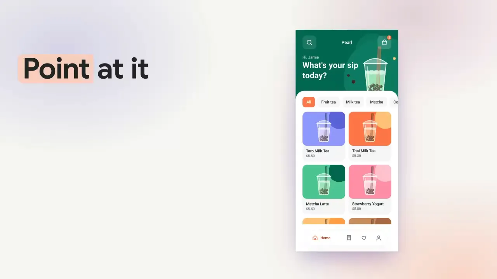
</p>
<p align="center"><sub>Point at it, hot swap, interactive and every screen — all real renders of Pearl, the sample app in <a href="fixtures/pearl"><code>fixtures/pearl</code></a>.</sub></p>

Your agent can edit a Compose screen, but it can't see it. So after every edit you wait for an Android Studio build to check it, and explain what's wrong with a screenshot.
Prevue redraws the Preview about a second after each save and shows it to your agent. The agent edits and checks on its own, and you only look at the finished screen.

<p align="center">
  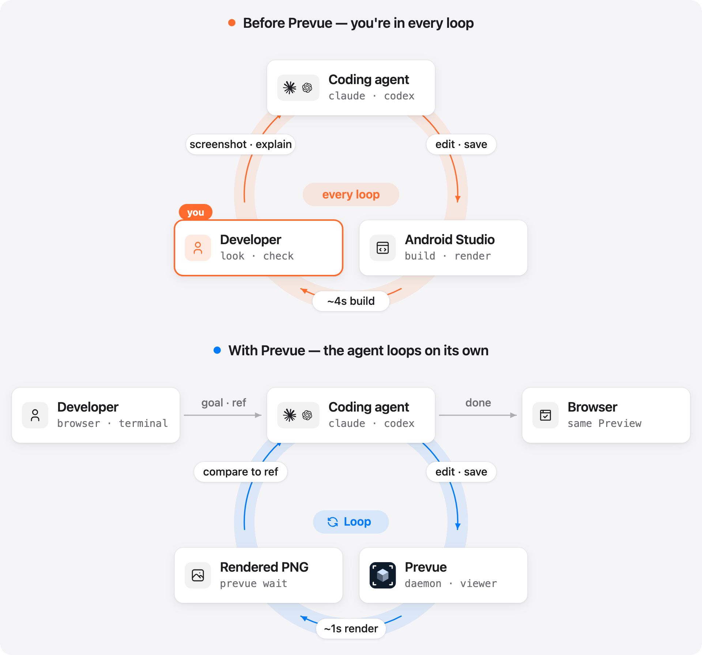
</p>

## Your agent checks its own work

Give it a design — a Figma frame, a screenshot, a mockup — and the agent edits, looks at the redrawn Preview, compares it with the design, and edits again on its own. You confirm the finished screen in your browser.

```
Make the ForYouScreen header match this screenshot
```

<p align="center">
  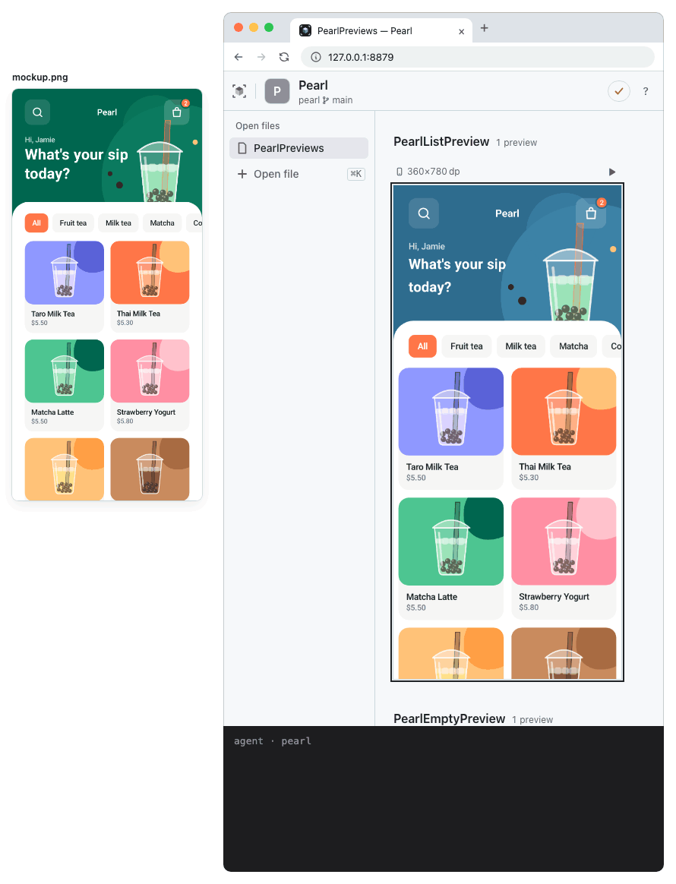
</p>

Screens that only change when you tap or drag work the same way. The agent switches the Preview into interactive mode, sends touches, and gets the new picture back.

## Hot swap

Save, and the Preview redraws in about a second without Gradle. Change only a value — padding, a color, a string — and it takes about 0.2 seconds ([Benchmark](#benchmark)).
Every `@Preview` in a file is laid out on a board grouped by function and redrawn on every save. The agent and you look at the same board, so "it's done" and "I see it" happen at the same moment.

<p align="center">
  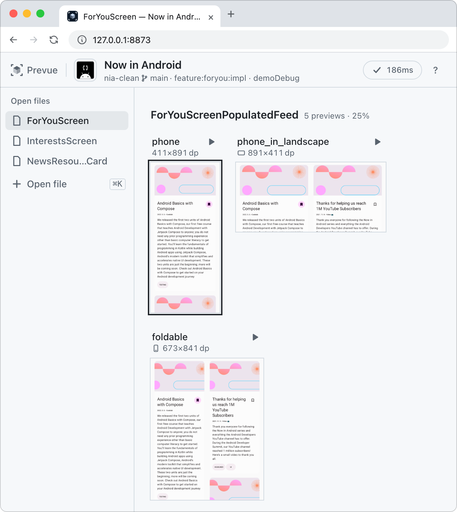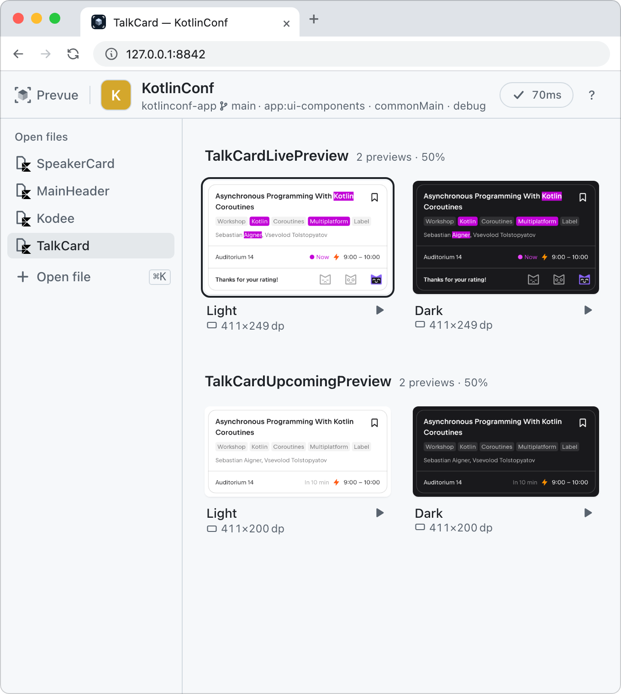
</p>
<p align="center"><sub>Left: <a href="https://github.com/android/nowinandroid">Now in Android</a> (Apache-2.0) · Right: <a href="https://github.com/JetBrains/kotlinconf-app">KotlinConf app</a>, Compose Multiplatform (Apache-2.0)</sub></p>

Kotlin Multiplatform and Compose Multiplatform modules work the same way. Prevue draws their commonMain Previews from the module's Android compilation, as Android Studio does, so modules that also target iOS or the web are fine. Compose Multiplatform resources (`Res`) draw as they do in the app.

Switch between a screen file and its component files while you edit, and the open files stay in the list on the left. `/` or `⌘K` finds a file by name, initials (`fys` → `ForYouScreen.kt`), or Preview function name. Press `?` in the viewer for every shortcut.

## Every preview at a glance

Once a project has many preview files, it's hard to find one whose name you don't remember. **All Previews** lays every preview file out as a card, so you can browse and pick by eye. The most recently changed come first.
Each card shows the file's previews with its name, package, and module. Click one to spread out its first few previews and go on to its board.

<p align="center">
  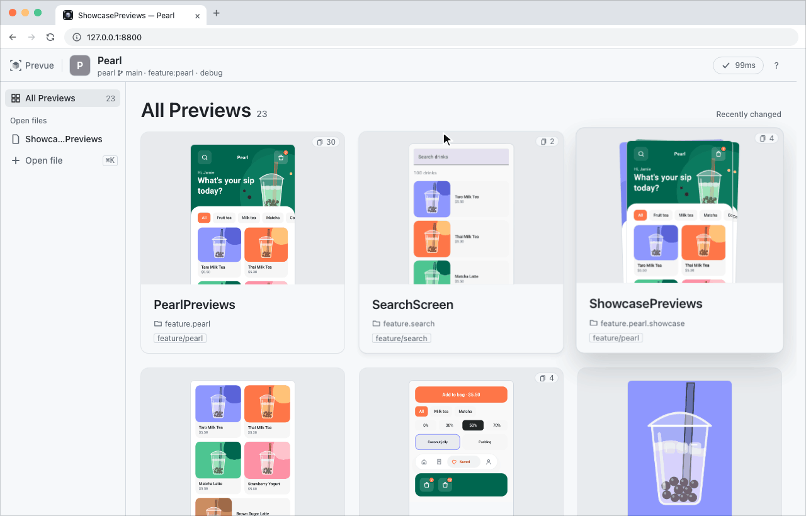
</p>

## Point at it

Describing the spot to fix in words is tedious. Click it in the Preview and just tell your agent what to do. No screenshots, no "the second card from the top."

```
Tighten the padding on this
```

The agent reads "this" as a file and line. `@path#Lline` is also copied to your clipboard, so you can paste it into a terminal.

A card opens beside the picture with what you pointed at: its name, its file:line, its size and its modifiers, plus a small tree of the elements around it. Click a row to point at a parent or a sibling, or jump to a Preview that calls it.

<p align="center">
  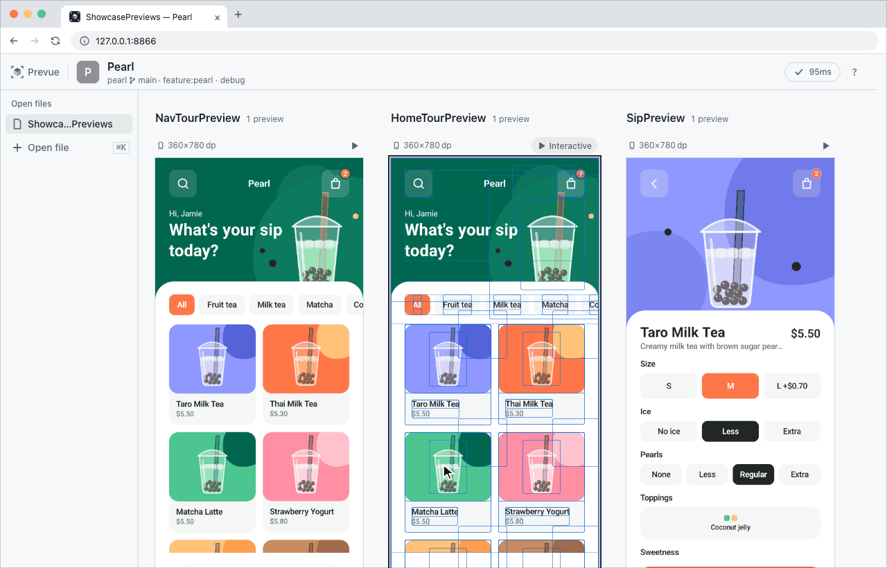
</p>

## Interactive mode

Press a card's `▶` to open it large. Like Android Studio's Interactive Mode, click and drag to check motion and animations.
Without touching the source, change the screen size or the device (18 Galaxy, Pixel and iPhone models), turn it to Portrait, Landscape left or Landscape right, and fold or unfold foldables.

- **Real device insets reach your Composable**, from [windowinsets.info](https://windowinsets.info/) and [safearea.info](https://safearea.info/).
- **Show inset areas** draws each inset band and the safe area over the picture.
- **Each device draws its own system UI** — Android, iOS and iPhone Duo status bars and cameras, in the PNG your agent reads as well as in the browser.

<p align="center">
  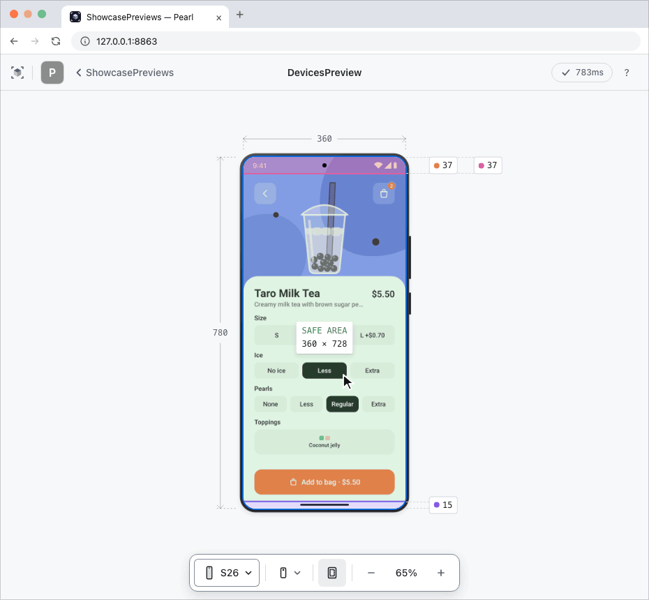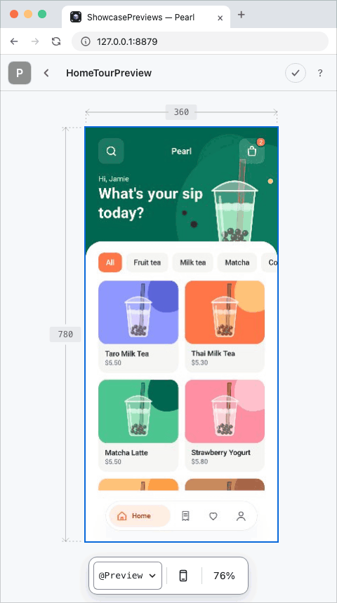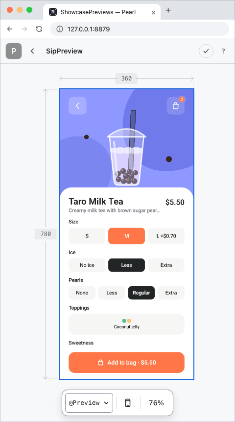
</p>

## Three agents, still light

One Preview in Android Studio keeps a Gradle daemon and a Kotlin daemon running too, about 8GB. We gave three agents a worktree each on a 36GB Mac, and the three Android Studios started swapping until every task slowed to a crawl.

With Prevue, every worktree gets its own lightweight daemon.

- **83% less memory** — one daemon compared with Android Studio ([Benchmark](#benchmark)).
- **Each window redraws on its own** — two agents saving at the same time don't mix, and when only one saves, the other window stays put.

<p align="center">
  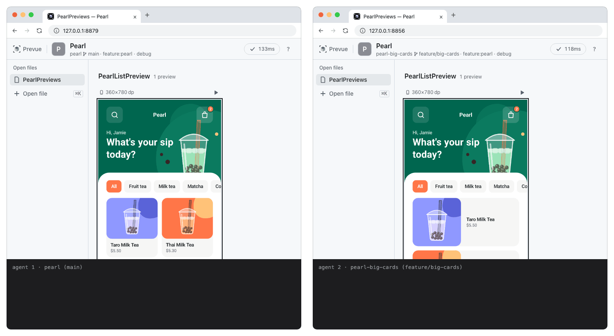
</p>

## Get started

### Requirements

- **macOS** with the Command Line Tools (`python3`) — if they're missing, the agent opens the installer for you.
- **Java** — with Android Studio Ladybug (2024.2) or newer installed, there's nothing to set up, even if your project uses JDK 17.
  - Older Android Studio releases bring Java 17, which the preview server can't run on.
  - Without Android Studio, install JDK 21 or later. `brew install openjdk@25` needs no sudo, and Prevue finds it there (or under `Library/Java/JavaVirtualMachines` or SDKMAN) by itself. 25 or later starts about a second faster.
  - Set `PREVUE_JDK` only to pick a different one.
- **Android SDK** — with at least one platform. Set `ANDROID_HOME` if it isn't at `~/Library/Android/sdk`.
- **Jetpack Compose** — `androidx.compose.ui:ui-tooling` 1.10 or newer (Compose BOM 2025.12.00 or newer). With an older one, previews fail with a message that ui-tooling doesn't pair with the renderer. Every release is drawn with the newest stable and alpha Compose before it ships.

### Install

```sh
# Claude Code
claude plugin marketplace add https://github.com/kakao/prevue.git
claude plugin install prevue@prevue

# Codex
codex plugin marketplace add https://github.com/kakao/prevue.git
codex plugin add prevue@prevue
```

Then tell your agent the file name. Calling the skill directly is more reliable: `/prevue` in Claude Code, `$prevue:prevue` in Codex.

```
Show the Previews in ForYouScreen.kt
```

Kotlin Multiplatform and Compose Multiplatform projects work the same way: name a file in commonMain.

There's nothing to configure. The first time you run it, the agent does the setup it needs, checking with you as it goes. When it's done, your browser opens with every `@Preview` in that file.
Prevue doesn't change your project's build files, plugins, or tasks, and it doesn't add files to your project. Gradle runs only once per module; after that, even edits to shared modules redraw right away.

### Update

Refresh the marketplace info first, then update the plugin. If you skip this step, it reads the old version info and says it is already up to date.

```sh
# Claude Code — takes effect after a restart or /reload-plugins
claude plugin marketplace update prevue
claude plugin update prevue@prevue

# Codex — there is no update, so run add again
codex plugin marketplace upgrade
codex plugin add prevue@prevue
```

Changes are in [CHANGELOG.md](CHANGELOG.md).
If you get stuck, ask your agent to read `prevue log`. If that doesn't help, [let us know in an issue](https://github.com/kakao/prevue/issues/new?template=not-working.yml).

## Supported

| Works | Doesn't work |
|---|---|
| Android modules (app · library) | Pure JVM modules |
| KMP · Compose Multiplatform modules with an Android target¹ | KMP modules without an Android target, non-Gradle builds (such as Amper) |
| commonMain files — redrawn on save without Gradle | Files with `expect` · `actual` — old picture until a Gradle build |
| Debug-type variants² | Release variants |
| Top-level `@Preview` functions (including Multipreview · `@PreviewParameter`) | Member Previews inside a class |
| Composables that draw without a real device | Previews that need a DI container or `AndroidView`³ |

<sub>¹ AGP 9's `com.android.kotlin.multiplatform.library`, or `kotlin.multiplatform` with `com.android.library` · ² Picked by Android Studio's default Build Variants rules; ask your agent for another · ³ Shown with the failure kinds `DI` · `ANDROID_VIEW`</sub>

## Benchmark

The top chart compares the same work in Android Studio and Prevue. The bottom chart shows how long each kind of change takes to show up.

<p align="center">
  
</p>

<p align="center">
  
</p>

- **Setup** — Apple Silicon, 14 cores · 36GB RAM. Android Studio 2026.1.3 was measured on 2026-09-22 and Prevue (develop `feb5c6e`) on 2026-10-23
- **First Preview** — Android Studio from opening the project, Prevue from starting the daemon
- **Memory** — Android Studio is the IDE plus the Gradle daemon. Going back and forth between modules for a long time, Prevue peaked at 1.6GB, and it shuts itself down after an hour without use (`prevue start --idle <minutes>` changes this)
- **Disk** — With JDK 25 or later, a class cache of about 200MB in `~/.prevue/aot` adds to this
- **Literal and resource-value saves** skip compilation, so they're faster

## Commands

These are commands the agent calls, so you rarely type them. The executable is `bin/prevue` in the directory where the plugin is installed.
See every command and exit code with `prevue --help`, and each command with `prevue <command> --help`. Four are worth typing yourself.

| Command | What it does |
|---|---|
| `prevue open` | Reopens a closed viewer in the browser |
| `prevue stop` | Stops the daemon started in that repository (`--all` stops every running one) |
| `prevue log` | The daemon log — ask your agent to read it when you're stuck |
| `prevue paths` | Where the toolchain, dumps, and outputs live and how much space they take — for finding what to delete |

## Contributors

<a href="https://github.com/kakao/prevue/graphs/contributors">
  
</a>

## License

This software is licensed under the Apache 2 license, quoted below.

Copyright 2026 Kakao Corp. http://www.kakaocorp.com

Licensed under the Apache License, Version 2.0 (the "License"); you may not use this project except in compliance with the License. You may obtain a copy of the License at http://www.apache.org/licenses/LICENSE-2.0.

Unless required by applicable law or agreed to in writing, software distributed under the License is distributed on an "AS IS" BASIS, WITHOUT WARRANTIES OR CONDITIONS OF ANY KIND, either express or implied. See the License for the specific language governing permissions and limitations under the License.
